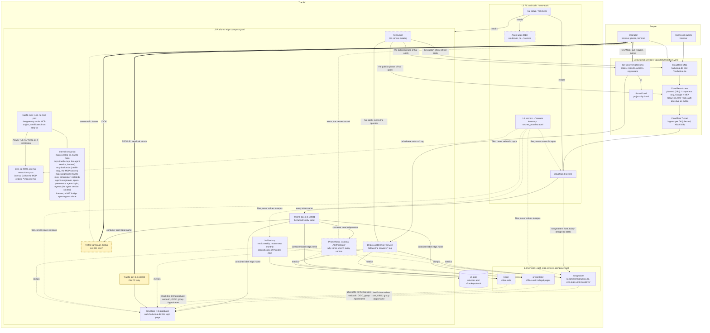

# Platform concept: from a bare PC to every service live behind the login (16.10.2026)

**Caller:** the operator, 16.10.2026:
- „nimm an ich muss es neu aufsetzen => welche Schritte muss ich wie machen? … was ein Script oder ein Tool machen kann soll es abnehmen … nichts doppelt und logisch getrennt … nach Ausführung sind dann all meine Dienste live hinter meiner Login-Seite und ich kann einfach User verwalten und Dienste an oder ausschalten“;
- „kann das nicht auch ein Script? zumindest durchleiten zu den Seiten?“;
- „all meine Tokens und Passwörter zentral verwaltet und auch checken, dass meine Seiten nur diese Keys haben“;
- „wie läuft das Deploy?“, then: „nicht einfach auf main, sondern wenn es ein Versions-Tag gibt … das den Deploy-Job triggert“;
- „Grafana sollte für die Plattform sein, also alle Dienste“ (ruled 16.10.2026).

**Read-only basis:**
- edge: README, `compose.yaml`, `keycloak/` (`master.yaml`, `realm.yaml`), `backup/`, `src/hal/backup/settings.py`, `systemd/`, CI;
- home-tools: README, `secrets_manifest.toml`, its file tree;
- songmaker: `scripts/auto-deploy.sh` and its system units, `docker-compose.yml`, `src/songmaker_cli/auth_api.py`;
- webauth: `src/webauth/oidc_login.py` (exists);
- presentator: `~/presentator-live` and its user units;
- hopin: README, Makefile, settings;
- issues edge#1, #4, #11, #13, #19 and home-tools#9, #10, #17, #21; hopin#25; presentator#196 and #197;
- the plan `ext-as-code.md` (OpenTofu, E3, its slices listed in the epic's body);
- live state: listeners, containers, timers, `/etc/cloudflared/config.yml`, `/etc/docker/daemon.json`, the operator's groups (`docker`, `sudo`), names in `~/.secrets` (names only), key names (not values) in the `.env` files.

No secret value was read. No write API was called.

**How to read it.** Each word in **bold caps** is one of the three places: **LOOK**, **PEOPLE**, **CHANGE**. "Today" means it exists and runs. "Planned" means a ruled plan or an open item. Every command is written `hal <verb>`. A verb that `hal --help` does not list, or a flag that `hal <verb> --help` does not list, is planned: not built yet, wherever this document names it. "Proposed" means this document proposes it and the operator decides (section 9).

---

## 1. The picture

> **The whole system on one page.** A solid box exists today. A dashed box is planned and not built yet. Thick arrows are the operator's three places: LOOK, PEOPLE and CHANGE.



**What the picture says, in six sentences:**
1. **The way in.** Every name ends in one tunnel. Cloudflare Access is planned to block every name that is not explicitly opened (`*` = operator only, X8b on #30); the operator ruled on 20.10.2026 that Zero Trust is not needed for now and can be added at any time, so today `auth` goes live as `public` and the `*` protection waits for X8b. Traefik on loopback hands each name to the container with that `edge.name` label, and the alias of that container (`edge.alias`) too.
2. **The login.** Keycloak at `auth.hallucinai.de` is the one login page. Every app checks the ID itself through webauth and its group `/apps/<name>`. songmaker joins only through its own cutover (section 3); until then it keeps its own login. Tools without their own login will sit behind Access (X8b); no login-less tool is published before it.
3. **PEOPLE.** People and their groups exist only in the Keycloak admin, `http://localhost:8090/admin/`, on this PC (later via Tailscale).
4. **CHANGE.** Every change is a pull request. A release (the planned `hal release` sets a `v*` tag) is deployed by the service's watcher; whether the service is then reachable depends on its state (section 8 state table). The platform (edge) and the external services change when the operator runs `hal apply`.
5. **LOOK.** One traffic-light page answers "is it OK now?" for every service, the backup, the drift checks and the secrets. Grafana answers "why, and since when?" for every service. Both send alerts through one e-mail channel.
6. **Agents.** Today agents run as the operator's user and can do whatever he can. Every "an agent may not" in this document is a request until D14 gives them their own user.

---

## 2. The layers

Each layer has **one** owner. The order is the order of a setup: a layer needs only the layers above it.

| Layer | Holds | One source of truth | Bring up | Check | Stays manual, and why |
|---|---|---|---|---|---|
| **L0 PC and tools** | Ubuntu packages (Docker, with the `journald` log default, cloudflared from apt, gh, uv, restic, the pinned `tofu`, Tailscale); `/etc/docker/daemon.json` (the system step merges the log default into it); edge's `tunnel/` (the cloudflared unit, its drop-ins, the stop-only polkit rule); linger; auto-login off; the AppArmor profile; the agent user (only with D14); the `hal` and `aco` tools; the work clones in `~/git` | home-tools: the setup playbook (home-tools#9; Ansible recommended there; it installs edge's `tunnel/`) | `~/git/home-tools/bootstrap` (new, home-tools#9), then `hal setup` (asks one `yes`; `--dry-run` only shows) | `hal check` (daily timer, today) | OS install and disk encryption (the installer decides it); BIOS "power on after AC loss"; the first `gh auth login --web`, because cloning the private home-tools needs it |
| **L1 secrets** | every token, password and key; values only in `~/.secrets`; tool logins in their tools' stores. Directories 0700. Files 0600, except a file a container user must read: 0644 inside its 0700 directory (docs/keycloak.md). Today every agent can read all of it (D14) | `src/hal/workstation/secrets_manifest.toml` (names, purpose, reader, scope, bindings, rotation; never a value) | `hal setup` (its step „Geheimnisse“): walks every missing secret page by page (home-tools#10) | `hal secrets`, part of `hal check` (today: local view; the remote check is section 4) | creating a token at the provider: a human logs in and clicks. The wizard opens the page, takes the value hidden, verifies it, stores it (HopIn's Cloudflare TURN key ID and API token: stored, not verified) |
| **L2 platform** | Traefik, socket proxy, Keycloak and its DB, step-ca (the internal CA for the MCP origins) and `traefik-mcp` (the second Traefik, the only container on the internal networks `mcp-ca`, `mcp`, `mcp-backends` and one per app, `hal_mcp_songmaker`; no host port), `legal` (nginx serving the imprint, the privacy notice and the terms that `hal apply` builds from the section of every block into `legal/built/`, on its own internal network; its one catalog host is the apex, public for the pages `cloudflare.redirect.serve` names), hal-backup timers, the deploy watchers, the LOOK page (Gatus: "is it OK now?"), the monitoring stack for every service (Prometheus, Grafana, Alertmanager: "why, since when?"; moves out of songmaker, ruled 16.10.2026, edge#4), one alert channel | edge: `compose.yaml`, `traefik.yml`, `traefik-mcp.yml` and `mcp/dynamic/`, `keycloak/*.yaml` (realm as code), `legal/` (frame, edge's own sections, stylesheet, nginx config; the built pages are not in git), `step-ca/ca.json`, `backup/apps.toml`; the timers' job declaration `src/hal/workstation/jobs.py` | `hal apply --local` (start without publishing), then `hal apply` (publish), then `hal online` (open the tunnel; section 6 step 11). Proposed: one command for compose, realm apply, timers, services on/off, external | `hal check` (`hal check exposure` today; proposed: plus readiness, backup freshness, deploy state) | the Keycloak go-live once (edge#19: it creates the permanent admin from a typed name and password; TOTP and passkey in the browser) |
| **L3 external** | Cloudflare DNS, Access apps and policies, tunnel ingress (D6), the zone's HSTS setting; GitHub repo settings, rulesets, Actions policy, org secret names and reach | edge `fleet.yaml` + OpenTofu (`ext-as-code.md`, epic E3, its slices listed in the epic's body) | the publish phase of `hal apply` (operator, TTY, the word `yes`) | `hal check hosts` → `hal check` | secret values, the tunnel object and its credential, Access identity providers, the Access group's one member, SonarCloud projects, CodeQL default setup, GitHub App installs, the registrar. Each has no provider or would put a secret into state |
| **L4 services** | songmaker, presentator, hopin, the agent service (its compose service and image recipe live in edge; switched on by its unit in `fleet.yaml`), later the aco board | each service repo's `compose.yaml` (containers) + its entry in `fleet.yaml` (where it runs, who may use it, on or off) | the deploy watcher (newest `v*` tag) after `hal apply` turned the service on | the LOOK page (each service's health URL); Grafana for its metrics | creating a new repo's SonarCloud project (one click) |
| **L5 data** | Docker volumes (songmaker DB and audio, Keycloak DB; `step-ca` ([internal-ca.md](internal-ca.md) names its backup) and `traefik-mcp-acme`, which is not: its certificates are issued again), the restic repository and its off-disk copy (D3), the encrypted OpenTofu state | edge `backup/apps.toml` | `hal restore …` (section 6) | the restore test (monthly), the clean-machine drill (section 6), and the backup's freshness on the LOOK page | the restic password, the OpenTofu passphrase and the disk's recovery key live in the password manager: without them no backup, no state and no disk can be read |
| **People** | users, passkeys, group memberships (`/apps/<name>`, `/services/agent-service/subscription`, `/services/agent-service/api`, `/services/speech-service`) | the Keycloak database (managed only in the admin console); the groups themselves are code in `keycloak/realm.yaml` | first-ever: create people in the admin console; re-setup: restore the Keycloak DB | Keycloak events (login anomalies) on the LOOK page | everything: people are never code (ruled) |

**Tunable values live in configuration** (ruled 27.10.2026). A value the operator tunes, such as an interval or a threshold, belongs in configuration he edits, so a change needs no build: `~/.config/hal/config.toml`, one table per timer job, read by `src/hal/config.py`. A value that a privacy page states, for example a retention, is app-owned (ruled 27.10.2026): each app defines its own values and its own privacy section, hal only assembles them, and the values live in a versioned configuration file in the app's repository, so CI sees them, not in the operator's local configuration. An app-owned consistency check of those values against the text is planned and not built.

**Who calls whom (no step twice):**
- `hal setup` installs the tools and clones edge. It creates the agent user only after D14 is ordered; until then the user is D14's step, not setup's. It installs cloudflared disabled and never starts a service.
- `hal setup` (its step „Geheimnisse“, the wizard) creates secrets. Nothing else writes into `~/.secrets`, except `keycloak/go-live` for the three Keycloak service passwords and one secret per confidential app client (edge#19 rule 2, edge#106), `step-ca/init` for `~/.secrets/step-ca/` (edge#38), `agent-service/setup` for `~/.secrets/agent-service/` (edge#234), which also creates `~/.secrets` itself and narrows it to 0700, as `secrets_view.LOOSEST_DIRECTORY_MODE` judges and `hal restore` on a re-setup.
- `hal apply` is **the one publisher**. `hal apply --local` runs only the local part: the platform and the enabled services. `hal apply` without `--local` runs the local part, then its publish phase: the OpenTofu publish and its check of each host against the catalog (built, edge#171). The two run one after the other and each asks its own `yes` only when it has changes (ruled 20.10.2026); with nothing to change `hal apply` asks nothing. A local part that does not end clean publishes nothing, and `hal apply` then exits 3, the same as for a publish that does not end clean (3 for every outcome of the stack that is not "applied or nothing to do"); the finer split of the stack's outcomes waits for [edge#50](https://github.com/overnightworks/edge/issues/50). It never creates a secret: when a service's setup is missing it asks **separately** ("step-ca has no keys yet. Create them now? (yes)") and then delegates to the existing owner, `step-ca/init` or `keycloak/go-live`, which keep the key generation, and the operator runs `hal apply` himself. For `--local` this is built ([edge#69](https://github.com/overnightworks/edge/issues/69)): the question comes before the plan, the setup runs in the operator's terminal with its output uncaptured, `--check` runs again, and a fresh plan follows with its own `yes` (R2, ruled 16.10.2026, [edge#50](https://github.com/overnightworks/edge/issues/50)). `keycloak/go-live` never publishes.
- The deploy watcher deploys newer tags and nothing else.
- What `hal apply`, `hal start` and the watcher may do in each state: section 8 state table.
- `hal check` only reads. It runs the checks secrets, hook, logs, backup and platform (containers, the pending reboot and free disk space).

### The agent service (A1d) in the layers

The agent service is an L4 service: the one place that holds the subscription logins and runs the provider CLIs for every app ([agent-runtime#18](https://github.com/overnightworks/agent-runtime/issues/18)). It sits behind Keycloak (its client `agent-service`), reaches MCP servers only over https through `traefik-mcp` (edge#37 slice 2), and trusts the internal CA's root (section 4). It runs from edge's `compose.yaml` (the service `agent-service`, profile `agent-service`) with an image built on the PC; the unit `agent-service` of `fleet.yaml` starts it with its egress gateway. Six rulings of 16.10.2026 shape it. The library contract stays owned by agent-runtime; each line here only states the ruling and links its owner.

1. **Closed environment.** Every CLI child is started by the library's one spawn owner with an explicit environment, an absolute binary and an explicit cwd, and inherits nothing from the host ([agent-runtime#10](https://github.com/overnightworks/agent-runtime/issues/10)).
2. **One private root.** Everything a child may write lives below the host's `cli_working_directory_root` (0700): the private credential homes, `TMPDIR` and the Codex sandbox directories; the library owns the layout below the root and the host owns the root ([agent-runtime#10](https://github.com/overnightworks/agent-runtime/issues/10), [agent-runtime#49](https://github.com/overnightworks/agent-runtime/issues/49); the host's owner of the root is Songmaker, [songmaker#1476](https://github.com/overnightworks/songmaker/issues/1476)).
3. **Sandbox policy from that root.** The host derives its AppArmor profile and Bubblewrap mounts from the root and allows writes only below it, for songmaker today and for the agent-service container in A1d, because a closed environment is not access control and hiding the operator's real `~/.claude` is a deployment matter of one directory bind per profile, read-only except `codex/`, which the service renews ([agent-runtime#10](https://github.com/overnightworks/agent-runtime/issues/10), [agent-runtime#18](https://github.com/overnightworks/agent-runtime/issues/18)).
4. **MCP origins: https only, with step-ca** ([edge#37](https://github.com/overnightworks/edge/issues/37), option d).
5. **No provider text in logs.** Provider text never reaches a service or library log or an exception chain; the host receives a sealed excerpt and alone decides whether to write it down ([agent-runtime#9](https://github.com/overnightworks/agent-runtime/issues/9), [agent-runtime#56](https://github.com/overnightworks/agent-runtime/issues/56), [agent-runtime#68](https://github.com/overnightworks/agent-runtime/issues/68)).
6. **The library defines its contract, hosts adapt to it** ([agent-runtime#49](https://github.com/overnightworks/agent-runtime/issues/49)).

**What this means for the platform (A1d):**
- The realm carries the callers' identity (#183): the realm role `agent-workload` held only by the service accounts of the songmaker, presentator and hopin clients, whose default scopes add the `agent-service` audience, so an app's workload token has the same `azp` as its people's tokens. Whoever holds such a client secret can get that token, which is why the secret stays the app's own file.
- The container mounts only one directory bind per provider (its login, read-only except the Codex directory, which the service renews and so binds read-write), its configuration file and two tmpfs mounts: `cli_working_directory_root` and `/tmp` (section 4).
- Its AppArmor/Bubblewrap policy permits writes only below that root.
- Its egress is exactly two names, through `agent-egress` ([edge#189](https://github.com/overnightworks/edge/issues/189)): an SNI-allowlisting TLS passthrough to the provider endpoint `api.anthropic.com` and the issuer host for the JWKS fetch. The service sits on internal, isolated networks with no route out, no host address and no DNS forwarding. MCP origins stay internal over `mcp`. The API route of the agent service reaches its provider through LiteLLM (`docs/agent-service.md`, "The API route").

---

## 3. The service catalog

### One file, one entry per repository

The catalog is **`fleet.yaml`**, the manifest that epic E3 already plans for OpenTofu. A second catalog would duplicate the repo list and the host names. E3 is being built slice by slice (state: #30); `fleet.yaml` is already this catalog, so there is no second one.

**Four changes to the E3 plan** (made once, when E3 is opened):
- **Location.** `fleet.yaml` moves from `external/` to the edge root, because L2 (deploy, LOOK) reads it too. OpenTofu reads `../fleet.yaml`.
- **A `run` block** on the entries that run on this PC. A library such as webauth has no `run` block, only `repo`.
- **Entries, not repositories, are the unit** (P1, P2, P14, ruled in [edge#50](https://github.com/overnightworks/edge/issues/50)). Platform units are entries keyed by their compose profile (`step-ca`, `keycloak`; socket-proxy and traefik are the always-on core), and repositories are entries with `repo`. One repository can carry several switchable units. `src/hal/stack/catalog.py` owns the typed `run` schema (`enabled`, `setup`, `build`); `run.setup` names the key command behind its `--check` contract (edge#52 rule 8). `run.build` names the recipe directory of the unit's one built image (a directory of this repository holding a `Dockerfile`; today `agent-service/image`): `hal apply` swaps that service's image in one recreate, and until the build moves into apply its setup builds a missing tag (edge#482). Images, volumes and ports are never repeated in the catalog. `docs/naming.md` records that catalog keys equal compose profile names (P5).
- **The tunnel mode is decided once, by D6 here**. It replaces E3's D5. D6 is ruled („Cloudflare steuert“, 18.10.2026): Cloudflare manages the configuration, the JSON credential stays, and OpenTofu writes the ingress lines from the catalog. That is planned, not live, until X6a's live apply (#168, L2); the catalog owns the whole tunnel configuration (D6).
- **X8: go-live does not publish**. E3's X8 makes `keycloak/go-live` step 8 call `edge external apply`. That would publish inside the go-live, before the re-setup's later publish step (section 6, step 11). Changed: go-live ends unpublished; the publish phase of `edge apply` is the only publisher. X8's "apply refuses while `auth` does not answer" stays, now inside `edge apply`.

```yaml
services:
  hopin:
    repo: {default_branch: main}   # the release branch; `visibility` (GitHub settings, E3, X2) is planned
    run:
      enabled: true              # Dienst an/aus: the one switch
      # setup: step-ca/init      # only where a unit needs key material (step-ca, keycloak)
    hosts:
      - name: hopin              # hopin.hallucinai.de → container labelled edge.name=hopin
        exposure: public         # own login; the * Access app would otherwise cover it
        reason: "video calls; every page needs the Keycloak login (hopin#25)"
        ready: /health           # optional: the path X8a asks before it publishes the host
        deny_public: [/auth/backchannel-logout]   # Cloudflare refuses the route at its edge
        # target: http://127.0.0.1:8081   # optional; this is the default (Traefik)
```

Planned and not accepted by `catalog.py` yet: `run.login_group` (a group of `keycloak/realm.yaml`, checked by CI), `run.health` (the LOOK page's path) and `run.deploy: tags` (the watcher, section 5). An app's `run` takes only `enabled` (no `setup`, no `build`), its `repo` only `default_branch`, and `github.org` names the organisation of its repository.

`src/hal/stack/catalog.py` (`hosts()`) owns the host shape. The publish phase of `hal apply` refuses an invalid catalog before any token is read; `external/hosts.tf` reads the valid shape.

| Field | Type | Default | Rule |
|---|---|---|---|
| `name` | string, required | none | `@` (the zone's apex), `*` (the wildcard) or one lowercase DNS label, no dot; `edge-host-check` is reserved (the host check asks the wildcard there), also in a disabled entry |
| `exposure` | `public` \| `bypass` \| `protected`, required | none | `protected` only on `*`, and `*` only `protected`; `public` on a label is refused while `*` exists (it needs its own `bypass`); one FQDN once |
| `reason` | string | none | required and non-blank for `public` and `bypass` |
| `ready` | path | none | starts with one `/`; the publish guard of X8a |
| `target` | `http://127.0.0.1:<port>` or `http://localhost:<port>` | `http://127.0.0.1:8081` (Traefik) | never `:8090` (the admin entrypoint); another target only for a gap-35 host (songmaker's `songmaker`) |
| `deny_public` | list of paths | none | each lowercase and absolute (`[a-z0-9._~-]` segments), no query, no trailing slash. Cloudflare refuses these paths at its edge, before the tunnel, one rule per path for every host listing it, with their encoded, cased and multi-slash variants (`docs/external.md`); songmaker's one host lists `/auth/backchannel-logout` (#213) and `/metrics` (#342), hopin's host lists `/auth/backchannel-logout` |

The apex and `www` are hosts only as the catalog's `cloudflare.redirect` (the apex also as `legal`'s host while `serve` is set) (validated next to the hosts by `src/hal/stack/catalog.py`): `hosts` (`@` or labels, none of them a service host except the apex while `serve` is set), `target` (an https URL) and `serve` (`pages`, lowercase paths, and `files`, a lowercase prefix ending in `/`, which the apex answers itself through its tunnel line; the apex then needs an enabled host). Cloudflare answers 302 at its edge, for https only (`http://` first goes to https on the same host): everything but the served paths goes to `target`, path and query dropped; old links keep no path (operator ruling of 18.10.2026). The names keep proxied records and have no tunnel line, except the serving apex, whose host is `legal` (`docs/external.md`). Keycloak's bare address already redirects to the account console, so `target` is `https://auth.hallucinai.de/`; `/impressum`, `/datenschutz`, `/nutzungsbedingungen`, `/favicon.ico` (the browser's own request, which must not go to auth; the unit answers it 404) and everything under `/_rechtliches/` are served by `legal` at the apex (every other form of a page, such as another case, a trailing slash or `www`, goes to the exact apex path).

`run.enabled` decides both the units and the hosts: only `true` and `false` count: OpenTofu's `yamldecode` also reads YAML 1.1 words (`yes`, `no`, `on`, `off`, `y`, `n`, `True`) as booleans and PyYAML disagrees on some of them, so every other spelling, `no` and `"false"` included, is refused. A disabled entry's hosts are validated but not published.

### What the catalog drives, and what it must not duplicate

| Fact | Owner | The catalog… |
|---|---|---|
| Containers, images, ports, volumes, the `edge.name` label | the service repo's `compose.yaml` | names only the host. A planned area of `hal check` reports an enabled host without a running container that carries its `edge.name`, a running `edge.name` that no enabled host lists, and a long-running service container whose restart policy is not `unless-stopped` (section 8: switches must survive a reboot). |
| Keycloak groups | `keycloak/realm.yaml` | references nothing today: the catalog has no `login_group` (planned, above), and no check compares the catalog with the groups of `realm.yaml` |
| What to back up | `backup/apps.toml` | says nothing. No check compares `apps.toml` with the catalog |
| DNS, Access app, tunnel line, repo settings | the catalog itself (rendered by OpenTofu) | is the owner |
| The LOOK page's service lights, Prometheus's scrape targets | the catalog | `hal apply` renders the Gatus endpoint list and the scrape list from the enabled entries |
| The deploy watchers | the catalog | `hal apply` installs one watcher per enabled entry with `deploy: tags` |
| The release branch | the catalog (`repo.default_branch`) | the planned `hal release` tags that branch |

**Why the catalog does not generate `realm.yaml`.** keycloak-config-cli adds and changes and deletes no undeclared top-level object or person: every `IMPORT_MANAGED_*` type is `no-delete` (`compose.yaml`), so a group missing from the YAML stays with its members (docs/keycloak.md). Even so, `realm.yaml` stays the group owner. Switching off never touches a group. Deleting a group is done in the admin console, after a backup, with the operator's yes.

### "Dienst an/aus" end to end

**Off** (example: hopin):
1. **CHANGE.** The operator, or an agent on his word, opens a PR in edge: `enabled: false`. CI checks the catalog rules. He merges.
2. **He runs `hal apply`.** It shows the plan and asks for `yes`:
   - hopin's watcher is removed;
   - hopin's services are stopped and removed, exactly the services the unit resolves to (P13, [edge#50](https://github.com/overnightworks/edge/issues/50)): never a project-wide `down`, which would also take shared services such as Traefik, and never `--volumes`, so the named volumes stay;
   - the LOOK page drops its light, Prometheus drops its target;
   - the publish phase of `hal apply`: the DNS record, Access app and tunnel line go.
3. **Result (R1, ruled 16.10.2026, [edge#50](https://github.com/overnightworks/edge/issues/50)).** "Off" removes a service's containers and never its volumes, data mounts or keys; "on" again uses the same identity and data. `hal apply` never deletes a volume; removing one stays a manual command. hopin is in state E (section 8 state table): closed as soon as its container is gone, before the external part finishes.

**On:**
1. A PR sets `enabled: true`. He merges and runs `hal apply`.
2. `hal apply` fetches hopin into `~/srv/hopin` (`src/hal/stack/deploy_checkout.py`), takes its newest release (`vYYYY.MM.DD.N` on origin's default branch, `src/hal/stack/releases.py`) and shows the tag in the plan (old → new for an update; the sha is not printed). After the operator's `yes` (the gate: whoever can put a tag on a merged commit offers code to run here) it checks out detached the commit the tag named when it was planned, never a tag resolved again, builds, creates and starts the containers under the switch lock, waits until every container runs and every container that has a healthcheck is healthy, and only then records the last successful deployment (`~/.local/state/edge/deployed/<key>`: tag, sha, time). A new tag that fails stays: the run is partial and the fix is a newer tag. No output of Compose is ever printed: a failed step names step, tag and exit code (`src/hal/stack/apps.py`, `src/hal/stack/app_compose.py`). The app's `compose.yaml` is held to one contract before the `yes` (`src/hal/stack/app_contract.py`, a pure check over the file at the tag; a failure means cannot plan, and every line names entry, tag, service and key, never a value): present at the root and self-contained (no `include`, no `extends`, no `profiles`, `name` absent or the key); each host of the entry has exactly one service labelled `edge.name: <host>`, or `edge.alias: <host>` beside an `edge.name` (one optional second host of the same entry, different from the name, matching `^[a-z0-9-]{1,63}$`; no list), with `traefik.enable: "true"`, and that service has a `healthcheck` (another service may have none; example: `web` carries `edge.name: presentator` and `edge.alias: presentator-talk` for an entry listing both); no `ports`, no `network_mode: host`; `restart: unless-stopped` on every service; no volume entry without a source; a `$` where a value decides a rule is refused: in a label key, `edge.name`, `edge.alias` and `traefik.enable`; in any short-form volume entry (`source:target[:mode]`, which Compose splits only after interpolating, so write it in the long form), and a short-form entry whose first section is one letter is refused too (Compose reads it as a Windows drive, so write it in the long form); in a long-form volume's `type`, `target` and the `source` of a volume-type mount (a bind's `source` and `read_only` may interpolate); in a tmpfs mount; and in the healthcheck's `test` and `disable` of a labelled service. `traefik.enable` counts only as `true`. The contract is a tripwire for cooperative app heads: it binds the cases it lists, and the boundary that would stop a non-cooperative one is D14, which is not built. A one-shot (`restart: "no"`) and a `depends_on` that waits for health or completion are refused for now. After build and pull and before `create`, an image-declared `VOLUME` that no named volume, bind or tmpfs of its service covers ends the run partial with nothing started and the record unchanged. Every host of an app in `fleet.yaml` carries `ready`; the app planning refuses one without it before the `yes`.
3. The publish phase then publishes the name, behind its `ready` guard (X8's "protection before reachability"). hopin is in A, or in C under a global stop (section 8 state table).

**Off (R1).** An app whose entry says `enabled: false` while containers of its project exist is switched off by the file-free `docker compose -p <key> stop` and then `rm -f` (`src/hal/stack/apps.py`, `src/hal/stack/app_compose.py`): every container of the project goes, old service names and leftovers included, whatever the checkout's `compose.yaml` says (Compose's `rm` skips one-off containers of `compose run`, which are then removed by ID with `docker rm -f`, never `-v`, and anything still left ends the off partial), so a missing or invalid file at HEAD does not stop it. Never `down`, never `-v`, no volume command: the plan row, shown before the `yes`, says `switch off` with the volumes and the checkout `~/srv/<key>` kept, and the record stays. Off fetches nothing, and a disabled app with no container plans nothing. On again at the same tag finds the same named volume with its data, because an app keeps persistent data only in named volumes.

**The realm apply (R3, ruled 16.10.2026; re-cut by the operator's „ja d“ and „ok“ on 21.10.2026, [edge#50](https://github.com/overnightworks/edge/issues/50), [edge#219](https://github.com/overnightworks/edge/issues/219))** adds and changes in the realm and deletes no undeclared top-level object and no person:
- it runs only when an input changed, and does nothing otherwise (R3, ruled 21.10.2026): the entry of `keycloak-config-cli` in `applied.json` is missing, unfinished or differs from the digests of `realm.yaml`, `master.yaml` and hal's digest of config-cli's resolved service (binds inside the checkout relative, so moving the checkout is no realm change), or Keycloak's own import-checksum attributes differ from the ones recorded after the last apply (a restored database, a go-live import). A rotated client secret alone does not trigger it. Once it runs, config-cli reconciles for real (`IMPORT_CACHE_ENABLED=false`);
- every `IMPORT_MANAGED_*` type is `no-delete`, and a listed user keeps the realm roles and groups the console gave it (client roles are reset), so the tool deletes no undeclared group, client, role or top-level flow and no person, and the reset below is the only loss;
- a Keycloak-only backup (`hal backup keycloak --pre-apply --json`, the last ten pre-apply snapshots kept) and its restore test come before it, as a step inside `hal apply` (R2); a failure of either applies nothing;
- one row `realm applied` comes after it, one detail line per change under it, and a reset-class removal is printed as „reset to the file“ with the snapshot's short ID, exit 0 (R4); the list of what exists only in Keycloak follows the change lines, only when the step runs, without changing its outcome (`src/hal/stack/realm/declared.py` reads the declared identities, `reconcile.py` compares them with the observer's);
- deleting anything in Keycloak waits for the operator's yes.

What the file declares belongs to the file: a console change to a declared object is reset by the next apply that runs the realm step, together with what hangs off it (a step or subflow in a declared flow, a mapper on a declared scope or client, a default or optional scope on a declared client that lists its scopes, a client role on a listed service account, a console-enabled service account on a declared client, a flow binding override on a declared client). What the console creates on its own stays: people, their memberships, and the groups, clients, roles and top-level flows the file does not declare. No person is ever deleted (a service-account user that a console-enabled service account on a declared client created goes with that reset). A change to a declared object goes into the file; the blockquote in docs/keycloak.md after „Theme and language“ lists the measured examples, and the Keycloak probe's proofs 3c and 3d pin them.

**Today's switch** is different: "off" means removing a tunnel line by hand, as on 14.10.2026 for presentator. Planned with X6a (#168): the ingress comes from the catalog, so a line is no longer removed by hand. Before presentator is published, its own Access app (its people, plus the `/sources/*` bypass) must still answer 401 to a request without a session; the operator checks that himself. The wildcard `*` protection is X8b.

**Emergency switches are separate:** `hal stop hopin` takes it offline at once without a code change. Guards: section 8 state table.

### The deployed record: a read-only interface

A program of another repository may read the record of `hal apply`: the last deployment of an app that settled. It is not the watcher model's `deployed.tag` and `deployed.sha` of section 5. Today the file is `~/.local/state/edge/deployed/<key>`, with `<key>` the catalog key; the state directory is renamed by #207 H5h, which carries this subsection and the path across.

- **Shape.** One JSON object with the keys `tag` (a release tag `vYYYY.MM.DD.N`), `sha` (the full 40-character commit of that tag, lowercase hex) and `time` (ISO 8601 with a UTC offset). The file has mode 0600, so only the operator's user reads it. A rule for readers, held by policy and by no test (the exact-key assert in `tests/test_stack_apps.py` only trips when the keys change): new keys may appear, and none of these three is renamed or removed without asking the readers first.
- **When it is written.** Only after every container of the app is settled: running, and healthy where it has a healthcheck. So it names the last deployment that settled, never a newer tag that failed, and it says nothing about what runs now: a stop or a failed update leaves it as it was.
- **Missing, unreadable.** A missing file means `hal apply` never recorded the app (it may run from before the record existed, or from another mechanism). A file that `hal apply` cannot read as a record is an error to report, not a missing file.
- **Readers.** A rule for readers, held by code reach and by no test: a reader never writes, deletes or locks the record; only `hal apply` writes it. A reader reads it while no `hal apply` runs; nothing here is promised for a read during one, nor across the state move of H5h.

### The legal pages: sections, frame and the section contract (v1)

`hal apply` builds `/impressum`, `/datenschutz` and `/nutzungsbedingungen` while `services.legal` is
enabled. The pages are not files in git: `legal/frame/` holds the markup (one skeleton per page and one
template per block kind), `legal/sections/<unit>/<page>.html` holds the texts, and `legal/built/` (git-ignored)
holds the result, which the legal unit serves. The pages take their tokens and fonts from the installed appkit: the appkit step of `hal apply` writes its static files to `appkit-<version>/` (git-ignored; the version is the lock's) in `legal/assets/`, served at `/_rechtliches/appkit-<version>/` whether or not the legal unit is enabled, and in the `resources/` of both Keycloak themes, which Keycloak serves under `/resources/<id>/`. A unit's text is a **section**; the imprint is one whole page
with no sections. A page's blocks stand as the general part (`allgemein`, edge's own), then the services
(`agent-service` under `#agent-dienst`, `keycloak` under `#anmeldung`), then the apps (their catalog key
is the anchor), each group sorted by anchor. A section directory with no catalog entry builds no block. Edge's
services and songmaker's text, which edge holds until songmaker ships its own, are built while their entry is in
the catalog, enabled or not. Apps' own texts are not read yet (edge#110).

What `hal apply` does: it validates every section, builds the pages and compares them with `legal/built/`. The
plan prints one row per kind, without a heading, above `core`: `+ legal  2 new pages`, `~ legal  1 edited page` and `~ legal  3 new records` (a page that matches while its record is missing, unreadable or stale), each with the page names. Under an edited page, from a record of what the last write was made of, each block stands as a dim line, new, changed or left (`legal/sections/songmaker/datenschutz.html#songmaker changed`), and a changed page frame (its skeleton or a table-of-contents template) as its own line; a missing or stale record makes every block new. It prints no legal row when nothing changes. The record is `legal-built.json` in the apply state beside `applied.json` (not beside `legal/built/`, which nginx serves), written after the pages; a page whose bytes already match is still planned (and the record written) while its entry is missing, unreadable or stale. After
`yes`, before any unit switches, it writes each changed page (a temporary file, mode 0644, renamed over the page).
Without an enabled `legal` unit there is no step and no line. A refusal comes before the question (exit 2) and
changes nothing; a failed write is partial with no unit switched (exit 1). A page goes live only that way, and a
wrong text is taken back by the next change of the text: there is no override.

**Format.** German, UTF-8 without a byte order mark, at most 65,536 bytes, LF line ends, no control character
other than LF.
```
fragment := WS h2 WS (block WS)* (section WS)*
h2       := '<h2 id="' ANCHOR '">' TEXT '</h2>'
section  := '<section id="' ANCHOR '-' SLUG '">' WS h3 WS (block WS)+ '</section>'
h3       := '<h3>' TEXT '</h3>'
block    := '<p>' INLINE+ '</p>' | ('<ul>'|'<ol>') WS ('<li>' INLINE+ '</li>' WS)+ ('</ul>'|'</ol>')
INLINE   := TEXT | '<br>' | ('<strong>'|'<em>'|'<code>') TEXT ('</strong>'|'</em>'|'</code>') | '<a href="' HREF '">' TEXT '</a>'
TEXT     := one or more characters; & < > written exactly as &amp; &lt; &gt;; no other character reference
WS       := spaces and LF only (may be empty)
```
The general part is edge's own and not part of what an app sends: several `h2` (`ID := [a-z0-9]+(-[a-z0-9]+)*`),
each followed by at least one `block`, no `section`, no `h3`, in the file's order.

Refused: any other element or attribute, a second, duplicate or valueless attribute; comments, doctype, CDATA and
processing instructions; a section in a section, a link in a link, a list in a paragraph or in a list item; an
empty paragraph or list item; text outside a paragraph, list item or heading; an unclosed element, or anything
but whitespace after the last closing tag (none, one or several line feeds and spaces: a file normally ends with one
LF). Between block tags any run of spaces and line feeds, or none, is free and published as written (`<ul><li>` and
`<ul>\n<li>` are both valid); a tab, a no-break space or a control character is refused. No script, style, image, form or external resource reaches a page.

**Canonical form.** `html.parser` only tokenises; every token is checked against the grammar, and the tokens are
written out again (lowercase tags, ` id="…"` and ` href="…"` with one space and double quotes, `<br>` without a
slash, text escaped as `&amp;`, `&lt;`, `&gt;` only). A file whose rewritten form differs from its bytes is refused
at the first differing line, so a section is published byte for byte or not at all (write `ä` or a no-break space
as the character, never `&nbsp;`; the line says so when it holds a reference other than `&amp;`, `&lt;` or
`&gt;`, such as `&quot;`, and a literal `"` in text stays valid). Edge re-emits only the structural tags with its own decorations; everything
inside them is the file's bytes.

**Ids.** The `h2` id is the anchor exactly (`[a-z0-9][a-z0-9_-]*`). Every other id starts with `<anchor>-`
followed by `[a-z0-9]+(-[a-z0-9]+)*`, and `titel` is reserved as the last word. An id stands once in the
assembled page, whatever its owner (a block or the frame); a clash refuses the run and names both owners. Existing
ids stay: edge renames or removes none of the stable ids without asking the apps that link them.

**Links.** `https://` with a host of two or more lowercase labels (no port, user, IP address or `#`), then an
optional path and query; `mailto:name@host` without a query; `#id`; `/impressum`, `/datenschutz` or
`/nutzungsbedingungen`, optionally with `#id`. A link to these pages written in full on the zone's apex or `www` is
refused: write the short form. A text may link its own ids and the stable ids below, nothing else, and every
`#id` link needs its target in the assembled pages. If the block it points at has left, the whole run is refused;
edge never rewrites a text to drop the link.

| Page | Stable ids |
|---|---|
| /datenschutz | `verantwortlicher`, `cloudflare`, `rechte`, `widerspruch`, `kein-tracking`, `automatisierte-entscheidungen`, `pseudonym`, `anmeldung`, `agent-dienst` |
| /nutzungsbedingungen | `recht` |
| /impressum | `verantwortlich`, `kontakt` |

**Stand** is the newest commit date of the page's section files (`git log -1 --format=%cs`); a commit that
changes only the frame does not move it. The imprint has none.

**Refusal line**, never quoting the text: `error: cannot plan, legal: legal/sections/songmaker/datenschutz.html: line 14:  is not allowed (allowed: h2 h3 section p ul ol li strong em code br a)`.
A change that would refuse a file valid under v1 is asked of every producing repository first; one that only
accepts more is announced.

**`hal legal KEY [DIR] [--repository TREE]`** runs this validator and the page assembly on the app's `legal/datenschutz.html`
(required) and `legal/nutzungsbedingungen.html` (optional) in `DIR` (default: the current directory), in the pages
as this checkout (or `TREE`) builds them and with its own held block for `KEY` left out. It prints the same refusal as above
as `error: legal: <path relative to DIR>: line N: <rule>` and exits 1, prints the row `✓ KEY  legal valid  <pages>` and
exits 0, and exits 3 when `DIR` does not exist; it writes nothing. A path under `legal/sections/` or `legal/frame/`
in the line is edge's, not the app's. Apps' own texts are not read from their releases yet.

### Hopin as the worked example: what it needs before its entry works

- **hopin#25 first:** login through webauth (`/apps/hopin`), Impressum and Datenschutz.
- **A `compose.yaml` and a Dockerfile** with `edge.name: hopin`, `restart: unless-stopped` and **no published port**. Hopin's container listens on 8080, which songmaker already uses on the host; Traefik reaches it by its bridge IP, so no host port is needed.
- **Its first release:** the planned `hal release hopin` tags the green tip of `main`.
- **The catalog entry above;** then `hal apply`.
- **Its SonarCloud project** already exists: hopin has `sonar-project.properties`.

### songmaker: from its own login to the one login

**Today songmaker signs people in itself.** It uses webauth's password login (`src/songmaker_cli/auth_api.py`: setup, login, password change). Its users and password hashes live in songmaker's own database. `realm.yaml` holds songmaker's client before the go-live, beside `agent-service` and the hopin and presentator clients (#161). So deploying songmaker behind the platform changes nothing for its users. D4 ("Keycloak for every app user") needs a cutover of its own.

**The cutover item** (songmaker; neighbours edge#19 and webauth; after go-live):
1. **Client.** edge's `realm.yaml` holds the `songmaker` client (#108), with its redirect URI on `songmaker.hallucinai.de`. Its secret is the file `~/.secrets/keycloak/clients/songmaker`.
2. **Login.** songmaker switches to webauth's OIDC login (`webauth/src/webauth/oidc_login.py` exists) and checks the group `/apps/songmaker`.
3. **Accounts.** Each songmaker user row gains the Keycloak user ID beside its own ID. Songs and albums stay keyed by songmaker's own ID, so no data moves. The operator first creates each person in Keycloak. A one-time mapping then pairs the two by username. He confirms each pair; nothing is matched silently. The admin role comes from a Keycloak group; the exact rule is a line in the item's expectation list.
4. **Retire the old login.** After every user has signed in once through Keycloak, the password form goes and the stored password hashes are deleted (deletion: spoken yes).

**Done when:**
- the mapping ran first on a restored copy of songmaker's data, with the same result;
- every existing songmaker user signs in through `auth.hallucinai.de` and sees their own songs;
- a person without `/apps/songmaker` is refused;
- the old password login answers 404.

---

## 4. The secret inventory and its check

### One inventory

`src/hal/workstation/secrets_manifest.toml` stays the one inventory. Values stay in `~/.secrets`. It gains five fields per entry:

| Field | Meaning | Example |
|---|---|---|
| `purpose` | one sentence: what breaks without it | "SonarCloud analysis in CI" |
| `scope` | the permissions it was created with, as declared | `["sonarcloud:analyze"]`; `["org:secrets:read", "repo:metadata:read"]` |
| `bound_as` | exactly where each app receives it: a compose secret file, or a named environment variable | `{app = "edge", file = "keycloak/db-password"}`; `{app = "presentator", env = "PRESENTATOR_SECRET_KEY"}` |
| `placed_at` | where a copy lives at a provider, by name | `github-org-secret:SONAR_TOKEN` |
| `max_age_days` | rotation rule (home-tools#10 line 15: a date only with provenance) | `365` |

Each app also gets one list of **plain keys**: the `.env` and `environment:` keys that are configuration, not secrets (example: `POSTGRES_USER`). Every key an app reads is then either a declared binding or a declared plain key. Nothing is judged by its name.

Today's fields stay: `name`, `kind`, `paths`, `read_by` (= consumer), `recreate`, `verify`, `retired_on`.

**Generated app secrets.** Any secret no human chooses is a `service-password` entry in `src/hal/workstation/secrets_manifest.toml`, kept in `~/.secrets` and mounted into the app as a file, never as an environment variable (ruled 22.10.2026, confirmed 27.10.2026). `hal setup` generates it unseen and keeps an existing value. Its mode is 0600, or 0644 inside its 0700 directory when the container user is not the operator, with a `loosest_mode_reason` on the entry. An app that fits this needs no question; only a deviation is asked.

**The internal CA's files (edge#38).** `step-ca/init` creates them once; `src/hal/workstation/secrets_manifest.toml` names them, with `loosest_mode = 0o644` for the files a container user reads, so the daily `hal check` judges them against that mode and never recommends `chmod 600`. Presence stays with each unit's own `--check`: every one of these entries is `optional`.

| File | Mode | Who reads it | In the backup |
|---|---|---|---|
| `~/.secrets/step-ca/root_ca_key` | 0600 | only `step-ca/init`, in a one-off container without a network; never mounted into the running CA | planned (Block 9) |
| `~/.secrets/step-ca/root_ca.crt` | 0644 | `traefik-mcp` (uid 65534, as the compose secret `step_ca_root_certificate`) and the agent service as the trusted root | planned (Block 9) |
| `~/.secrets/step-ca/password` | 0644 in the 0700 directory | the CA, through `/run/secrets/step_ca_password`; it protects the root and the intermediate key alike | planned (Block 9) |
| volume `step-ca`: `certs/`, `secrets/intermediate_ca_key`, `db/` | uid 1000 | the CA | planned (Block 9) |
| volume `traefik-mcp-acme`: `acme.json` (the issued certificates and their keys) | uid 65534 | `traefik-mcp` | no: they are issued again |

**The agent service's mounts (A1d).** Its container binds three things from the host (the two login directories and its `service.toml`), gets two compose file secrets (the signing key and the step-ca root), plus two tmpfs; the rulings are in section 2. It runs as `1000:1000`, the operator's uid on this PC, because its reader refuses a login file that group or others can touch.

| Mount | Holds | Mode | In the backup |
|---|---|---|---|
| one directory bind per provider, read-only except `codex/`, the one writable bind (the service renews that login and renames over the file), `~/.secrets/agent-service/<provider folder>/` (today `claude/`, the Anthropic login, and `codex/`, the Codex login, which `codex login` never writes directly: hal runs it in a fresh home outside the bind and moves only `auth.json` in; the file inside is replaced, the directory never) | that provider's subscription login, one file | the container user only (0700 directory, 0600 file); no other provider's login and not the operator's `~/.claude` or `~/.codex` | no: the login is restored from its `~/.secrets` source ([agent-runtime#18](https://github.com/overnightworks/agent-runtime/issues/18)) |
| the compose secret `agent_service_signing_key`, `~/.secrets/agent-service/signing/private.pem` → `/run/secrets/agent_service_signing_key` (the private file alone, never the `signing/` folder) | the key the service signs app-tool capabilities with | 0600, owned by the container user; the service refuses to start otherwise | no: a lost key is replaced by `agent-service/setup --replace-signing-key` |
| the compose secret `step_ca_root_certificate`, `~/.secrets/step-ca/root_ca.crt` → `/run/secrets/step_ca_root_certificate` | the CA root the service trusts for MCP origins | 0644; no secret | see the step-ca table |
| `./agent-service/service.toml` → `/etc/agent-service/service.toml`, read-only | the service's configuration | the checkout's | no: it is in the repository |
| `cli_working_directory_root`, a tmpfs | the private credential homes, `TMPDIR`, the Codex sandbox directories | exactly 0700, owned by the container user (the service refuses to start otherwise); the library owns the layout below it | no: rebuilt on start |
| `/tmp`, a tmpfs, also its `HOME` | nothing the service keeps | 0700, owned by the container user | no |

**One split keeps it single.** The manifest owns *what a secret is and where an app receives it*. `fleet.yaml` owns *where GitHub installs it and which repos see it*: the org secret name and its reach (E3, X5). The value is set by the planned `hal secrets --rotate` (home-tools#10 line 19). Its reach is checked by `hal check hosts`. home-tools#10 line 19's own "repo list drift" view is therefore dropped; the reach check lives once, in X5.

### The check: `hal check` compares the inventory with reality

| Finding | Meaning |
|---|---|
| `missing` | the manifest names it, reality lacks it |
| `extra` / `undeclared` | reality has it, the manifest does not name it (for app keys: neither a binding nor a plain key) |
| `over-privileged` | reality grants more than `scope` declares |
| `stale` | older than `max_age_days`, expiring within 30 days, or unused for 90 days |
| `unverified` | the check cannot prove the deployed value equals the central one, and says so |

Every finding names the subject and a page to fix it, never a value.

**What the check can prove, and what not.**
- **A compose secret file is `bound_as`** when the container's mount source is exactly the declared `~/.secrets` path. That proves the central file is what the container gets, not that the app reads it: **consumption stays `unverified`** unless the app exposes a check (a health field naming the secret's fingerprint, never its value). The check reads only the mount path (`docker inspect` `.Mounts`), never the file.
- **An inline literal in compose is a finding.** It is reported by key name only, value redacted, and never printed or logged.
- **An environment variable is `unverified`,** always. Its value comes from a `.env` file or the shell. Metadata cannot show it equals `~/.secrets`. The fix is to move it to a compose secret file (gap row 21); then it becomes `bound`.
- **A copy at a provider is `unverified`,** always (GitHub org secrets, Actions secrets). GitHub shows only `updated_at`. The check shows that date beside the local file's date, as a hint, never as proof.

**Safe extraction, so no value is ever printed:**
- compose: the file is parsed by the check's own YAML reader, which keeps `secrets:` paths and `environment:` key names and drops every value at once. `docker compose config` is never run, with or without `--no-interpolate`: those flags stop variable resolution, they do not redact literals written in the file.
- `.env` files: a parser that keeps each key and drops its value at once.
- containers: `docker inspect` mount sources only; never `.Config.Env`, which holds values.

| Source | What can be read, read-only | Credential needed | Findings |
|---|---|---|---|
| **`~/.secrets` on disk** | names, modes (`stat` only; today) | none | missing, extra (today: `unknown-file`), loose mode (0600; 0644 only where the file's manifest entry declares it as its `loosest_mode`, inside a 0700 directory; `bound_as` is the planned decider for compose files) |
| **App secrets in compose** | the safe extraction above, for every enabled service: `secrets:` file paths, `environment:` keys, `.env` keys in the deploy checkout, mount sources | none | `bound_as`, `unverified`, `undeclared`, `missing`, `inline-literal` (key name only). **Today every key in songmaker's and presentator's `.env` is `undeclared`,** because the manifest declares none. Among them are 8 secrets: songmaker's `SESSION_SECRET`, `POSTGRES_PASSWORD`, `ADMIN_PASSWORD`, `GRAFANA_PASSWORD`, `HF_TOKEN`, `SMTP_PASSWORD`, `SONGMAKER_INTERNAL_TOKEN`, and presentator's `PRESENTATOR_SECRET_KEY`. A name rule (`*PASSWORD`, `*SECRET`, `*TOKEN`) would have missed the last one |
| **GitHub org Actions and Dependabot secrets** | `GET /orgs/{org}/actions/secrets` and `/dependabot/secrets`: names, `visibility`, `updated_at`; `…/{name}/repositories`. Repo secrets: `GET /repos/{o}/{r}/actions/secrets`. **Never values** | fine-grained read token: org Secrets read, Dependabot secrets read, repo Secrets read, Metadata (E3's `github/fleet-read`) | extra (presentator's repo `SONAR_TOKEN` beside the org secret, ext G5); over-privileged (visibility wider than declared); stale (`updated_at` is a dated rotation with provenance); equality always `unverified` |
| **GitHub tokens themselves** | a fine-grained PAT's expiry: the response header `github-authentication-token-expiration` of any call made with it. A classic token's scopes: the `X-OAuth-Scopes` header | the token itself | stale (expiry); over-privileged against `scope`. The `gh` login keeps `admin:org` until E3's D6 (removing `admin:org`) removes it after X3c (kept on purpose for edge#29); its live scopes are read from the `X-OAuth-Scopes` header of `gh api -i user`. Listing *all* tokens with org access needs a GitHub App (`GET /orgs/{org}/personal-access-tokens`); a PAT cannot, so "extra tokens" stays a yearly glance at the settings page, unless D8 adds the App |
| **SonarCloud** | `GET api/user_tokens/search`: token names, `createdAt`, `lastConnectionDate`, `expirationDate`; `api/projects/search?organization=overnightworks` | a SonarCloud user token (read; verify which permission the project search needs when building) | extra and unused tokens; a repo with `sonar-project.properties` but no project |
| **Cloudflare API tokens** | each token verifies itself: `GET /user/tokens/verify` (or `/accounts/{id}/tokens/verify`) returns status and `expires_on`. A list of all tokens needs the permission "API Tokens Read" | the token itself; for the full list, one more read permission (D8) | stale, expiring; extra only with the list permission |
| **Cloudflare tunnels and Access service tokens** | `GET /accounts/{id}/cfd_tunnel`; `GET /accounts/{id}/access/service_tokens` (names, `expires_at`) | `cloudflare/fleet-read` plus Tunnel read and Service Tokens read | extra tunnel (a second live tunnel is an open door); expiring service token |
| **Keycloak clients** | the client list, which clients are confidential, their redirect URIs. The apply deletes no client, so a console-made client stays and appears as drift at the next read | a **read-only** service account in `hallucinai` with `view-clients` and `view-realm`. It cannot change anything and is not an admin credential (D8) | extra client; a confidential client whose secret file is missing in `~/.secrets` |

**The checks stay narrow.** Each source is one small reader returning findings in `hal check exposure`'s shape. GitHub and Cloudflare already come from `hal check hosts` (X5); only the token self-checks, SonarCloud, the compose scan and Keycloak are new. `hal check` aggregates them, with notify-on-change as today.

---

## 5. Deploy: a version tag triggers it

**Today** there is no watcher: `hal apply` takes the newest release tag on origin's default branch at the next run, after its plan and the operator's `yes` (section 3, "On"). The model below is the target.

### The model, the same for every service

| Branch or tag | Role |
|---|---|
| the default branch (`main`) | the always-green integration branch; a landing never deploys by itself |
| `v*` tag | a release. It is immutable: org ruleset 25224012 "release tags are immutable" blocks deletion, update and force-push of `refs/tags/v*` in every repo (checked 16.10.2026) |

**What each deploy watcher does** (one per service, a systemd timer every 2 minutes):
1. **Find the newest release.** It fetches tags and takes the newest `v*` tag whose commit is on `origin/<default branch>` and that is not in the skip list (see rollback). Guards: section 8 state table.
2. **Gate it.** songmaker's gate, carried over as it is and named (`auto-deploy.sh` from line 147):
   - only check runs from GitHub Actions count;
   - every Actions job must end `success`, `skipped` or `neutral`, and at least one must end `success`;
   - the job `SonarCloud scan` is advisory: its result never blocks a deploy.
   `hal release` uses the same rule, so "green" means one thing.
3. **Back up first if the schema changes.** If the tag's database schema differs from the running one (see rollback), the watcher runs the app's backup before it deploys. That backup is the way back.
4. **Deploy it.** It accepts only a tag from step 1 (see "What a deploy accepts"). `git checkout --detach <tag>` in the deploy checkout `~/srv/<name>`, then `docker compose build`, then a busy check (songmaker: no running job), then `docker compose up -d --wait`. songmaker's `migrate` service runs `alembic upgrade head` as part of this (`docker-compose.yml` line 49).
5. **Book it.** After `--wait` succeeds it reads the live database's schema version and compares it with the tag's `schema:`. Only an equal version writes the deployed tag to its state; songmaker's `deployed.sha` rule carries over as `deployed.tag`. A migration that succeeded but a health check or schema comparison that failed leaves the state `migrated, not healthy` with the live schema recorded, never the old tag; the LOOK page shows it red. The state is backed up, so a re-setup knows which version wrote the data.
6. **Alert.** After 3 failed ticks in a row, the LOOK page turns red and an alert goes out (songmaker's counters, unchanged).

**What a deploy accepts, and who may write it (D14).**
- **Only a release tag.** The deploy input is a `v*` tag fetched from the forge (step 1), protected by ruleset 25224012. Never a local working tree, branch or path.
- **Root-owned, not agent-writable:** the `hal` command and the `hal check` executable (installed by `hal setup` under `/usr/local`), the watcher units, and the deployment checkouts (`~/srv/<name>`, songmaker's auto-deploy checkout, the live edge checkout). The agent user cannot write them. Agents work in their own worktrees and reach a deploy only through a pushed, gated tag.
- **The proof:** `hal check` fails when any path on a deploy path (those executables, units, checkouts and the paths the watchers read) is writable by the agent user or by a group it is in.

**The watcher's GitHub credential** becomes a read-only token: Contents read and Checks read on the service repos (`github/deploy-read` in the manifest). Today songmaker's watcher calls `gh api`, so it runs with the operator's `gh` login (`repo`, `workflow`). A read token is needed at all because three watchers polling every 2 minutes make 90 calls an hour, above the 60 an unauthenticated client gets.

**Rollback: only when the old code fits the data.**
- **Why a rule.** songmaker migrates its database on every deploy. Code from the tag before may not understand the new schema. A blind rollback can break the app or the data.
- **The schema is declared.** `hal release` writes the schema into the annotated tag message: `schema: <alembic head>`, or `schema: none` for a service without a database, and optionally `schema-min: <head>` for the oldest schema this code still reads. The compatibility evidence for a rollback is the live database's version (read as in step 5, not taken from the state file) lying between the target tag's `schema-min` (default: its `schema`) and its `schema`.
- **The planned `hal rollback hopin`** deploys the tag before the current one only when that tag's declared schema fits the live database. It writes the bad tag into the skip list, `skipped` in `~/.local/state/edge/<service>.toml` (the watcher's state file). The watcher never deploys a skipped tag; it follows the newest tag that is not skipped. A newer tag deploys normally, and the entry stays until the operator removes it with the planned `hal unskip <service> <tag>`. The planned `hal restore <app> --tag <tag>` writes the same entry (below). While a skip is active, the LOOK page shows hopin yellow with "rolled back to vX, vY skipped".
- **When the live schema is outside that range, it refuses.** It says: "vY changed the database. Stop the service (`hal stop hopin`) and ask the operator." The way back is then `hal restore hopin --tag vX` (planned flag). It restores the backup the watcher took before vY (step 3), then deploys the chosen tag, which must be schema-compatible with that data (the same range check as above). It writes the bad tag into the same skip list; a newer tag is still picked up. The full walk is the incident table's row "A bad release" (section 8).
- This is a kill switch (ruling 12), not a change: the tags stay as they are.
- In which states rollback and restore may run, and when the service opens again: section 8 state table. Who may run them: section 8's command table.

### Who sets the tag, and when

**The release step is the head's, delegated like webauth's releases today.** webauth tags `v*` and never moves a tag: a broken release gets the next patch tag. It cut v0.12.0 and v0.13.0 on 15.10.2026. The operator never tags by hand.

**Why not tag every landing.** songmaker had 95 first-parent commits on main in the last 14 days, about 7 a day. One tag per landing would be main-deploy under another name. One release step per landing would add 95 extra agent dispatches.

**The rhythm (proposed default, D5):**
- **One batch release per service per working session,** after the last landing of a session, or when the operator asks ("release songmaker"). That is about 1–2 a day for songmaker, against 7 landings.
- **A fix for something broken in production** gets its own release right after its landing.
- **One release implementation, not one per repo: `hal release <service>` (planned).** It reads the service's repo and default branch from the catalog. It refuses unless that branch's tip passes the gate above. It picks the next version, writes the PR titles since the last tag and the `schema:` line into an annotated tag on that tip, and pushes it. The head runs it as a mechanical step (the cheapest routing row, low effort); no review, because the tag adds no code.
- **Version form for services:** `vYYYY.MM.DD.N` (example `v2026.10.16.1`). A service has no API consumers who need SemVer, and a date says at a glance how old the running version is. Libraries such as webauth keep SemVer and their own release. Both match `v*`.
- **aco's landing brief names the freed release.** "Landed, not released" is visible on the LOOK page as "the default branch is N landings ahead of the running tag", so nothing waits silently.

### What stays applied by the operator

- **edge itself** (L2): `hal apply` after his merge. It fast-forwards edge's live checkout, shows the plan and asks `yes`. Changing the gatekeeper, Keycloak or the backup is never automatic.
- **External** (L3): the publish phase of `hal apply`. Only the operator holds the write tokens (E3 rule 3).
- **Why not automatic.** Agents run as his user today, so any token on a timer would be an admin credential in an agent's reach. Automatic apply becomes possible only after D14.

### How each service joins

| Service | Today | Joins by |
|---|---|---|
| **songmaker** | system timer `songmaker-autodeploy.timer` (every 2 min) runs the 1,253-line `scripts/auto-deploy.sh` on `~/git/songmaker`, following `origin/main` once CI is green. The checkout is also the place `aco land` must not run (memory: land from `~/git/songmaker-land`) | the migration below |
| **presentator** | manual. `~/presentator-live` is a separate checkout at `1f0422c` and runs a locally built image (`presentator-adoption-instance:ap112-e04e837a`) on 127.0.0.1:8100. Two host user units run from that checkout: `presentator-speech` and `presentator-copresenter`; speech is crash-looping (stale socket file, seen 16.10.2026). Offline publicly since 14.10.2026 | its go-public item agent-presentator#197 adds a catalog entry with `deploy: tags` and its first `hal release`. It joins under §10 rule 1: the two host units and their unix sockets (its `compose.yaml:52-53`) and the `docker.sock` mount (`:51`) leave its release, so the watcher deploys the compose release and nothing on the host |
| **hopin** | deployed from its tag `v2026.10.26.1` as `hopin-hopin-1` | section 3's example: a compose file, then its first tag |

Every service that holds people's data also offers the export and erase routes of `docs/people.md`.

### Migrating songmaker off main-deploy

1. **The first tag.** The head tags the commit in songmaker's `deployed.sha` as `v2026.MM.DD.1`, with its `schema:` line, so the switch deploys nothing new.
2. **Its watcher follows tags.** In `scripts/auto-deploy.sh`, the deploy target changes from "newest green commit on `origin/main`" to "newest green `v*` tag on `main`". Everything else stays: the gate, busy check, base-image rebuild, Prometheus reload, the counters, the alert. It gains the backup before a schema change. This is a songmaker item; its tests already pin the script.
3. **A deploy checkout of its own.** `~/srv/songmaker`, cloned fresh. The `.env` moves with it (later: its secrets move to `~/.secrets/songmaker/`, section 7). `install-autodeploy.sh` points the unit there.
4. **`~/git/songmaker` becomes a plain work clone again.** `aco land` there is harmless, `~/git/songmaker-land` can go, and the memory note about it is retired.
5. **Later, once presentator needs a watcher.** The tag watcher moves from songmaker into edge as the one generic `edge-deploy@<service>` unit. songmaker keeps its busy check as its own health URL (`/deploy/ready` answers whether a job runs). Building the generic watcher before a second service needs it would be building for an imagined caller.

### On a re-setup

Section 6 step 8 starts every enabled service at the tag its backup recorded; from there the watchers above take over (when they run: section 8 state table). There is no separate "install-autodeploy" per repo.

---

## 6. The re-setup runbook: from a bare PC to every service live

Every step is either **one command** or a **guided step**. A guided step means the tool:
1. says in one sentence what happens and why;
2. opens the page;
3. says exactly what to click;
4. waits for Enter;
5. verifies by itself.

That is the operator's „zumindest durchleiten zu den Seiten“, and edge#19 rule 7.

**Nothing opens before the data is back and checked.** The runbook stays in column C of the section 8 state table from the first `hal apply` (step 6; on a first-ever setup, step 8) until `hal online` ends step 11 (C → A). Otherwise a user could write into an empty instance, and the restore would then wipe that write.

**Two paths:**
- **First-ever:** nothing exists. New secrets, Keycloak go-live once, people created by hand.
- **Re-setup:** the PC died or is reinstalled. The secrets and the Keycloak DB come back from the backup: no new passwords, no new passkeys for anyone. This needs D3, backup copies off this disk (one of the secrets, one of the data), and their restore path below. **Without D3, a new disk means the first-ever path:** every person enrols again, and songmaker's data is gone.

**What the operator needs at hand:**
- the password manager: the secrets backup's password, the data backup's restic password, the OpenTofu state passphrase, the disk's recovery key (D10), his Google login;
- his passkey device;
- the off-disk backup disk (D3).

| # | Step | Kind | First-ever | Re-setup | Done when (the tool verifies) |
|---|---|---|---|---|---|
| 1 | Install Ubuntu 24.04, disk encryption per D10, the operator's user | manual (the installer) | same | same | the desktop runs |
| 2 | `sudo apt install -y gh && gh auth login --web && gh repo clone overnightworks/home-tools ~/git/home-tools && ~/git/home-tools/bootstrap` | one line, printed on paper and at the top of `docs/architecture.md`; the login is guided by `gh`. **`bootstrap` does not exist today**; home-tools#9 builds it | same | same | `hal --help` answers |
| 3 | `hal setup` (asks one yes) | one command, asks for `sudo` once | same | same | `hal setup --dry-run` shows nothing left to change; `hal check` reports L0 clean (Docker loopback default, cloudflared installed and **disabled**, restic, `tofu` pinned, Tailscale, auto-login off; the agent user once D14 is done) |
| 4 | **Secrets** | guided | `hal setup`: per secret, open the provider page, paste hidden, verify, store (HopIn's TURN key ID and API token: stored, not verified). Generated service passwords need no typing | `hal restore secrets --repo <off-disk repository> --target ~/.secrets` (`--repo` planned): the recovery form below | `hal secrets` without findings |
| 5 | Tool logins: Tailscale, Claude, Codex (for the agent user, once D14 is done) | guided (part of step 4: the wizard runs each official login command) | same | the same; tool logins are not restored, because they expire and rebind | each `verify` passes |
| 6 | `hal apply --local --platform` (`--platform` planned) | one command | **skipped**: step 7 creates the Keycloak secrets first and starts the platform itself | first restores the Keycloak dump into the empty DB (the data backup's newest complete run), then starts Keycloak, so the realm, the people and the passkeys are back | 8081 and 8090 listen on loopback, Keycloak answers; the PC is in column C |
| 7 | `keycloak/go-live` (edge#19) | guided; runs **once ever**; never publishes (section 3, X8) | creates the Keycloak secrets, bootstrap admin, master on 8090, applies the realms; asks for the permanent admin's name and first password (hidden) and creates it; pauses for the browser step (TOTP and passkey); then deletes the bootstrap admin | **skipped**: go-live sees its done-states and changes nothing | another master admin with TOTP and a passkey exists, `temp-admin` is gone |
| 8 | `hal apply --local` | one command; shows the plan, asks `yes` | starts every enabled service at its newest tag | starts every enabled service at the tag its backup recorded as running (`deployed.tag`), so code and data fit | each health URL answers on loopback; every enabled service is in column C |
| 9 | Restore app data | one command per app: `hal restore <app> --live --repo <off-disk repository>` (new, section 7; `--live` and `--repo` planned) | — | loads each app's dump and files from the same data run as step 6 | the restore test's checks pass on the live data; the data's schema equals the running tag's `schema:` |
| 10 | Check it closed | `hal check`, then the operator opens each app on loopback | the apps answer, empty | he sees his songs and his people on loopback | every light green except "not published" |
| 11 | `hal apply` (publish), then `hal online` (open) | two commands; `hal apply` shows the plan and asks `yes` | `hal apply` publishes the DNS, Access and tunnel lines (C stays C); `hal online` then moves every enabled service C → A | the same; the restored OpenTofu state plans "No changes" for what still exists. A lost state re-adopts by name (E3 rule 6). From A on, section 5's watchers take each service from its recorded tag to its newest one | `hal check hosts` exit 0, then `hal check` exit 0 with every enabled service in A (every-service-in-A is a planned area) |
| 12 | **PEOPLE** | guided: the planned `hal people` opens `http://localhost:8090/admin/` on the users page | create each person and put them into `/apps/<name>` | nothing: the DB came back | the person signs in to their app |
| 13 | **LOOK** | open the traffic-light page | every light green | every light green | — |

### The off-disk restore path (D3)

Backups are separated (ruled 27.10.2026); [backup.md](backup.md) owns the rule. The secrets backup and the secrets-first restore are not built: today `hal backup` covers only the apps of `backup/apps.toml`, and `~/.secrets` is in no backup.

Today `hal restore` cannot restore on a clean machine: its settings fix the repository to `~/backups/restic` and the password to `~/.secrets/restic/password` (`src/hal/backup/settings.py`, `Settings.for_home`). On a new disk, neither exists. The recovery form changes four things:

- **Which repository.** `--repo` names it on the command line: the USB disk's path (later also the rclone `gdrive` remote). Nothing is looked up locally.
- **The password.** restic asks for it at a hidden prompt; the operator types it from the password manager. In recovery form `~/.secrets` is never read; it is the target.
- **Which snapshot.** The list comes from the repository itself (`restic snapshots`), never from the local `backup-status.json`, which is gone. Each backup run tags its snapshots with one run ID. The tool shows the runs newest first, with date and host, and takes the newest complete run unless he picks another. Step 4 takes the newest complete secrets backup; steps 6 and 9 use one data run.
- **Where the disk lives.** A USB disk on the desk dies with the PC in a fire or a theft. The `gdrive` copy is the later answer to that. A disk an agent can write to can also be wiped by an agent (D14).

**The proof: a clean-machine drill.**
- A throwaway machine (a VM or a spare disk) with no `~/.secrets` and no `~/backups`.
- Only the USB disk and the typed password.
- It runs steps 4, 6, 8, 9 and 10, and **never** step 11.
- It is done when the restore test passes there and an admin login works on its loopback. It checks data, not GPU jobs.
- D3 counts as done only after the first drill passes. The drill repeats after every change to the backup layout, and at least every 6 months. The LOOK page shows the last drill date.

**One-time pieces that never repeat on a re-setup:**
- the Cloudflare account and zone;
- planned (X8b; there is no Zero Trust today): the Access identity provider (Google);
- planned (X8b): the Access group's one member (the operator);
- the tunnel object (D6);
- the GitHub org, its App installs and the SonarCloud org.

They survive a dead PC because they live at the provider.

---

## 7. Gaps and duplicates

**Exists today:**
- `hal check`, `hal secrets` (view only);
- edge: Traefik, socket proxy, Keycloak as code with its probe, `hal check`, `hal alarm` (every 5 minutes, mails a service or backup finding after two runs in a row), hal backup with weekly and monthly timers;
- songmaker's auto-deploy, alerts and monitoring stack;
- the tunnel with songmaker's host and auth, then the terminal 404 rule;
- org rulesets 25224011 and 25224012.

### Duplicates: the same fact in two places

| # | What is double | Where | Owner item |
|---|---|---|---|
| 1 | The secrets list | `~/README.md` table (stale: names atelier2, tidy-home, `cloudflared/config`) and `secrets_manifest.toml` | home-tools#10, slice S2 |
| 2 | Tunnel credentials | `~/.secrets/cloudflared/<id>.json` and `/etc/cloudflared/<id>.json` | home-tools#21, but D6 keeps the JSON credential; which copy is the one stays with home-tools#21. #21 plans to delete the `~/.secrets` copy, which a re-setup from backup needs |
| 3 | Tunnel ingress | the catalog (its lines written by the publish phase of `hal apply`), the `ingress:` of `/etc/cloudflared/config.yml` (serving until the switch) | E3 slices X6 and X8, in the mode D6 ruled. The catalog is the owner; the `config.yml` cleanup is #144 (B7) |
| 4 | App groups | `keycloak/realm.yaml` (`/apps/songmaker`, `presentator`, `hopin`) and the catalog's `login_group` | **new slice in E3**: the catalog's CI checks against `realm.yaml` and `apps.toml` (section 3) |
| 5 | Org secret reach | home-tools#10 line 19 (repo-list drift) and E3 X5 (`fleet.yaml` org secrets) | home-tools#10 (drop its drift view) and E3 X5 (keep it) |
| 6 | Alert channels: three today | songmaker's e-mail (`songmaker-alert@`), Alertmanager inside songmaker, `hal check`'s desktop notification | edge#4: **one e-mail channel** (ruled 24.10.2026: `msmtp`, run as the operator, over the SMTP account songmaker uses). `hal check` mails its news itself; Gatus ("is it OK now?") and Alertmanager ("why, since when?") both send into it; songmaker's own e-mail alert goes |
| 7 | Deploy | songmaker's watcher only; presentator by hand, with locally tagged images; hopin none | **new item in edge**: "one deploy model: tag watcher and `hal release`". Its first slice is in songmaker (section 5) |
| 8 | Deploy checkout = work clone | `~/git/songmaker` is both; the workaround is the extra `~/git/songmaker-land` | the songmaker migration item (section 5, step 3) |
| 9 | Monitoring stack | Prometheus, Grafana and Alertmanager live in songmaker's compose, though they serve the platform | edge#4: **ruled 16.10.2026:** they move into edge and serve every service. songmaker keeps only its metrics endpoint and its dashboards as files edge loads |
| 10 | Two publishers | E3 X8 lets `keycloak/go-live` call `edge external apply`; section 6 publishes in `edge apply` | E3 X8, changed once (section 3): go-live never publishes |
| 11 | The zone name | `fleet.yaml` `cloudflare.zone` only: `hal apply --local` writes it to `.env`, and CI derives `EDGE_DOMAIN` from the same key | landed: edge#136 |

### Gaps: something missing

| # | Gap | Evidence | Owner item |
|---|---|---|---|
| 12 | Docker loopback default not set | `daemon.json` carries no `ip` key; the system step writes only `log-driver` | edge#291 (its done-when holds the clean-machine re-setup) |
| 13 | `tofu` and Tailscale not installed | `which` finds neither | home-tools#9 |
| 14 | No catalog, no `hal apply`, no catalog check | — | **new item in edge**: "catalog and `hal apply`" (with `--local` and the publish phase). Its caller is this concept; it depends on E3 X1; E3's X1a creates `fleet.yaml` at the root, and this item owns the `run` blocks |
| 15 | E3 not opened | the plan is a draft in `ext-as-code.md`; edge#1 row E3 is its placeholder | open E3 from that draft, with the four changes in section 3 |
| 16 | Keycloak go-live not run | edge#11 go-live row; script in edge#19 | edge#19, then edge#11; D14 does not gate it (ruled 16.10.) |
| 17 | Keycloak DB in the backup (closed with the go-live, #118) | hal backup backs it up and restore-tests it as a DB-only app (K11b, edge#107); its record in `backup/apps.toml` is live with the go-live (#118, after #178 took it out while Keycloak was off); go-live step 1 asks only while hal backup is not set up (K11b.2, edge#127) | K11b.2 in edge#11 |
| 18 | Live restore not scripted | songmaker's and Keycloak's are a manual procedure in [backup.md](backup.md), run only by the operator; re-setup step 9 needs `restore <app> --live` | **a new edge item** for the scripted `restore <app> --live` of both |
| 19 | Backup on the same disk, and no restore without the local disk | [backup.md](backup.md) says it: no protection against a dead disk. `Settings.for_home` fixes repository and password to local paths | **new item in edge**: "a second backup target off this disk, and the recovery form" (section 6); done when the clean-machine drill passes; its caller is D3 |
| 20 | `~/.secrets` not backed up | ruled 14.10.2026 (home-tools#8 closed: a wizard instead), changed by D3 | D3: its own encrypted off-disk secrets backup, separate from the data backup (section 6) |
| 21 | App secrets in checkout `.env` | 7 secret keys in songmaker's `.env`, 1 in presentator's; neither is in the manifest | **new item per app** (songmaker, presentator): compose `secrets:` from `~/.secrets/<app>/`, like edge does; plus manifest entries with `bound_as` (home-tools#21 can take the entries) |
| 22 | No LOOK page | Gatus proposed 15.10.2026; no item | edge#4: pull it as "LOOK: the traffic-light page, the platform's monitoring stack and one alert channel"; agent-coordination#24 (PC-Zentrale) folds into it or names it as its neighbour |
| 23 | The remote secret check | section 4: token self-checks, SonarCloud, the compose scan with `bound_as`, Keycloak | **new home-tools item** after E3 X5 (the GitHub and Cloudflare parts come from X5) |
| 24 | Agents held org admin | The `gh` login keeps `admin:org` until E3's D6 (removing `admin:org`) removes it after X3c (kept on purpose for edge#29); its live scopes are read from the `X-OAuth-Scopes` header of `gh api -i user`. `delete_repo` is removed (16.10.2026). songmaker's deploy watcher still uses that login. The bigger reach remains: row 31 | the `github/deploy-read` token in the songmaker migration item |
| 25 | Port 8090 claimed twice | edge's admin entrypoint is `127.0.0.1:8090`; `presentator-speech.service` sets `SPEECH_PORT=8090` and the copresenter `COPRESENTER_SPEECH_URL=http://127.0.0.1:8090`. Whichever starts first wins | agent-presentator#108 ("the voice is a setting, not a unit file"), or a new presentator item if #108 does not cover the port |
| 26 | hopin cannot run beside songmaker | default port 8080, no container | hopin#25 or a new hopin item "container with `edge.name`" |
| 27 | No release step | no service repo has tags; only webauth releases | `hal release` in the new deploy item (row 7) |
| 28 | Dead unit link | `agent-telegram.service` points to a moved file | claudebot#19 (the bot stays off) |
| 29 | No emergency commands | `hal status` and `hal lock`, the boot guard and its drift finding do not exist | **new item in edge**: "one operator CLI (`hal`) with emergency switches" (section 8). The daily check, backup and restore are the ruled `hal check`, `hal backup` and `hal restore`. The section 8 state table becomes this item's test table: one parametrised test per cell |
| 30 | The polkit rule for cloudflared exists only where `hal setup` ran | installed on this PC (#76, #144); a PC without it needs `sudo` to stop the tunnel | `hal setup` installs the stop-only rule `tunnel/polkit/10-edge-cloudflared-stop.rules` from edge (section 8) |
| 31 | **Agents run as the operator's user** | he is in the `docker` group (root on the PC) and `sudo`; `~/.secrets` is his; after go-live, `~/.secrets/keycloak/config-cli-secret` signs in as Keycloak master `admin` (`master.yaml`: `service-account-config-cli`, realm role `admin`), without TOTP | **new home-tools item** "secure the agents" (D14), aco as neighbour for starting sessions as the agent user |
| 32 | songmaker has no single-login cutover | its own password login; the app clients are in `realm.yaml` (#108, #161), only the songmaker cutover is still open | **new songmaker item** (section 3), after edge#19 |
| 33 | No `home-tools/bootstrap` | the file does not exist | home-tools#9 |
| 34 | No way to stop every agent at once | aco runs sessions on its own tmux socket but has no "stop all" command | **new item in agent-coordination** (aco owns agent sessions) |
| 35 | Songmaker's host (`songmaker`) and presentator bypass Traefik | tunnel ingress sends them to `:8080` and `:8100`; no ingress barrier can hold them (section 8) | the catalog and `hal apply` item (gap 14) routes every hostname through Traefik on 8081 (until then the host's `target` in `fleet.yaml` carries it, `http://localhost:8080` for `songmaker.hallucinai.de`); for presentator it lands with presentator#197. `www` is no tunnel host any more: it redirects at the edge (below), as does the apex except the paths `legal` serves as its host |

---

## 8. Betrieb und Notfall (operations and incident)

The operator asked: „wer verwaltet das Home / die Dienste? ggf eine UI-Seite, die Dienste an/abschalten kann? genauso wie gesamt Cloudflare stoppen? … dass ich über ein Tool bei Problemen schnell handeln kann?“

### Two kinds of action, never mixed

| Kind | When | How | Effect |
|---|---|---|---|
| **Planned change** | anything meant to last: a service on or off, a new name, a new group | a PR to the catalog or the code, merge, then `hal apply` (section 3) | the code is the truth; `hal check` is clean afterwards |
| **Emergency switch** | something is wrong *now* | one `hal` command in the operator's terminal; no code change | acts within seconds; what it does is the state table below. `hal check` leaves a switched-off app's stopped containers out of its findings, and the switch stays until `hal start` |

### The state table: the one owner of every guard

Every other section points here ("guards: section 8 state table") and restates none of it. The table owns *when* a command may act and which state it leaves behind; *what* a deploy, a rollback or a restore does to code and data is section 5's. Each state describes one service S; the global stop applies to the whole PC.

| State | Recorded | cloudflared | S's ingress barrier | S's watcher | S's containers |
|---|---|---|---|---|---|
| **A · running** | nothing | running | absent | runs | up |
| **B · switched off** | S's switch | running | present: Traefik answers 404 for every host S declares or routes | paused | stopped, or up behind the barrier after a restore |
| **C · global stop** | the global stop | stopped | absent | paused | up, reachable on loopback only |
| **D · global stop + switched off** | both | stopped | present | paused | as in B |
| **E · disabled in the catalog** | the applied catalog says `enabled: false`; a marker may remain from B or D | as the PC: running, or stopped under the global stop | absent, or S's barrier while its marker remains: either way every host S declares or routes answers 404 | none: not installed | removed; volumes kept (R1, section 3 "Off") |

**E takes precedence over A–D.** "Applied" means the live edge checkout, which only `hal apply` fast-forwards: a merged `enabled: false` changes nothing until `hal apply` runs, and from then on S is in E whatever its marker says. A marker that remains keeps a re-enabled S closed; see "How the states are held". The global stop still governs cloudflared for the PC; E does not touch it.

**A command on the whole PC** (`hal offline`, `hal online`, boot) applies to each service the cell of that service's own column. On a PC with X in C and Y in D, one `hal online` moves X to A and Y to B.

On a new PC nothing is applied yet: `hal setup` installed cloudflared disabled, and the first `hal apply` records the global stop, so every enabled service comes up in C and every disabled one is in E. A host that bypasses Traefik (gap 35) has no B or D: its only barrier is the tunnel.

A cell names what changes; everything it does not name stays as it is. "→ B" means S is in state B afterwards.

| Command | A · running | B · switched off | C · global stop | D · global stop + switched off | E · disabled in the catalog |
|---|---|---|---|---|---|
| `hal apply`, local part (alone: `--local`) | allowed: applies S's changed entry; when the catalog now says `enabled: false`, → E (steps: section 3, "Off") | allowed: never starts S; the plan says "S stays stopped" (a `·` row, "switched off since …" or "barrier stands"). When the catalog now says `enabled: false`, → E: S goes down for good; its marker and barrier stay, so a re-enabled S stays closed until `hal start S` | allowed: as A; cloudflared stays off | allowed: as B; cloudflared stays off | allowed: while the catalog says `enabled: false`, no change. When it says `enabled: true`: → B (→ D under the global stop) while S's marker remains; without a marker → A (steps: section 3, "On"), or → C under the global stop, where the new watcher stays paused |
| the publish phase of `hal apply` | allowed: writes DNS, Access, tunnel lines and GitHub settings; refuses a plan with changes, before `yes`, while an enabled host's `ready` path does not answer on its target; then checks each host against its declaration (protected by Access with the declared policy, public, or bypass) and fails on any mismatch or undeclared host ("fails" = the publish phase exits 1, also when the check cannot run; after an interrupt past `tofu apply` the check is skipped and the message names `hal check hosts`) | refused with changes while S declares `ready`: its unit is stopped, so its path does not answer (`hal start S` or `enabled: false` ends that); otherwise as A; S's names stay published and the barrier keeps answering 404 | allowed: as A; only the provider side changes, cloudflared stays off | as B: refused with changes while S declares `ready`; otherwise as C | allowed: as A; it removes S's names (section 3, "Off"), which answer 404 until then |
| deploy watcher (timer) | runs: deploys the newest green tag that is not skipped (section 5) | paused: does nothing | paused: does nothing | paused: does nothing | none: S has no watcher |
| `hal rollback S` | allowed: the rollback of section 5, which refuses itself when the live schema does not fit; S stays in A | refused | refused | refused | refused: "S is disabled in the catalog" |
| `hal restore S --tag T` (operator; `--tag` planned) | refused: "stop it first: `hal stop S`; for a host that bypasses Traefik, `hal offline`" | allowed: the restore of section 5. Containers run behind the barrier; barrier stays, watcher stays paused. S opens at `hal start S` | allowed (the only way for a host that bypasses Traefik): the same; containers run on loopback, cloudflared stays off, watchers stay paused. Opens at `hal online` | allowed: the same; barrier stays, cloudflared stays off, watchers stay paused. Opens only after both `hal start S` and `hal online` | refused, as rollback |
| `hal restore S --live` (`--live` planned; operator) | refused, as `hal restore S --tag T` | allowed: stops S, loads its dump and files, starts its containers behind the barrier; barrier stays, watcher stays paused | allowed: the same on loopback; cloudflared stays off, watchers stay paused (section 6 step 9) | allowed: as B; cloudflared stays off | refused, as rollback |
| `hal stop S` | → B: stops S's containers (`docker compose -p S stop`; volumes stay), renders the barrier, pauses S's watcher, records the switch. Refused for a host that bypasses Traefik: "`<host>` bypasses Traefik; migrate it first (gap 35). Until then use `hal offline`." | no change | → D: as A → B; cloudflared stays off | no change | no change: nothing runs |
| `hal offline` | → C: stops cloudflared, pauses S's watcher, records the global stop; containers keep running | → D: the same; S's switch, barrier and containers stay | no change | no change | S stays in E; the global stop is recorded for the PC |
| `hal start S` (operator) | no change | → A: clears the switch, removes the barrier, starts the containers when stopped, resumes S's watcher | no change | → C: clears the switch, removes the barrier, starts the containers on loopback. The watcher stays paused and cloudflared stays off until `hal online` | refused: "S is disabled in the catalog; enable it by PR and `hal apply`" |
| `hal online` (operator) | no change | no change: S's switch stays | → A: repeats the host check of the publish phase and refuses on any failure; then starts cloudflared (asks the operator's password); then resumes S's watcher | → B: the same check and the same cloudflared start; S's watcher stays paused, so S stays closed: barrier, paused watcher, containers as they are | S stays in E; the global stop ends for the PC |
| `hal unskip S T` (operator) | allowed: removes T from S's skip list; the watcher may pick T at its next tick | allowed: the same; the watcher stays paused | allowed: the same; the watcher stays paused | allowed: the same; the watcher stays paused | allowed: the same; it matters once S is enabled again |
| `hal secrets --rotate <name>` (operator; `--rotate` planned) | allowed: stores the new value, restarts S if S reads it | allowed: stores the value; restarts S only if its containers run after a restore, else they read it at their next start | allowed: as A; never starts cloudflared, even when it reads the secret | allowed: as B; cloudflared stays off | allowed: stores the value; nothing restarts |
| `hal check`, the planned `hal status` | allowed, read-only | allowed, read-only | allowed, read-only | allowed, read-only | allowed, read-only |
| boot | Docker restarts S (`restart: unless-stopped`), cloudflared starts, the watcher runs | Docker does not restart S, because it was stopped explicitly; barrier and paused watcher stay | cloudflared's drop-in keeps it stopped; S restarts on loopback; its watcher stays paused | both: S stopped, cloudflared off | nothing of S starts |

**How the planned state check of `hal check` proves the table.** It places every service in its column (E when the applied catalog says `enabled: false`, otherwise A–D from the markers) and checks that column's facts against reality:
- S's barrier file present, and a request to Traefik on 8081 with the `Host` of any host S declares or routes answers 404 from the deny service (B, D); no barrier file (A, C; E without a marker);
- S's watcher timer active (A), paused (B, C, D) or not installed (E);
- cloudflared active when no global stop is recorded (A, B, E), inactive when it is (C, D, E);
- S's containers up (A, C), stopped unless a restore started them (B, D), or absent (E).

Each mismatch is a red finding, for example a recorded switch without its barrier file. The operator-CLI item (section 7, gap 29) turns the table into its test table: one parametrised test per cell sets up the column, runs the row's command and asserts the cell with `hal check`.

**How the states are held.**
- **The markers (P7, [edge#50](https://github.com/overnightworks/edge/issues/50)).** One persistent marker per service and one global marker under `~/.local/state/edge/` record every switch and the global stop. They are written **before** anything stops, so the intent exists first. They replace the single state file for switches.
- **The ingress barrier.** Stopping containers is not enough, because cloudflared keeps running and a redeploy would bring the route back. So `hal stop S` renders a barrier for S directly under `<edge checkout>/dynamic/`, derived from S's marker. It is a flat file, never in a subdirectory, because the pinned Traefik does not watch subdirectories. It is generated and git-ignored, written atomically, and the deny route is verified before success is reported. The `./dynamic` directory is the one `compose.yaml` mounts as `/dynamic` and `traefik.yml` watches. The file holds a top-priority router for each host S declares in `fleet.yaml`, enabled or not (the apex included, as the router `switch-S-_apex`), and for each `edge.name` and `edge.alias` Traefik routes for S, each answering 404 from a deny service and beating the container's label router. A wildcard (`*`) line has no router of its own: the `edge.name` and `edge.alias` of the services it reaches stand for it. It covers only hostnames routed through Traefik; a planned `hal check` finding reports each hostname that bypasses it (gap 35).
- **The applied record ([edge#85](https://github.com/overnightworks/edge/issues/85), [edge#87](https://github.com/overnightworks/edge/issues/87)).** `~/.local/state/edge/applied.json`, beside the markers, holds for each service edge follows through a file it binds from the checkout the sha256 of each such file, as last fully applied: today `traefik.yml` (traefik), `traefik-mcp.yml` (traefik-mcp) and `agent-service/egress/traefik.yml` (agent-egress). A core service's compose definition (what `compose.yaml` runs without a profile) needs no record: it changed when `docker compose config --hash` differs from its container's `com.docker.compose.config-hash` label, which is Compose's own fact. `hal apply --local` recreates each running core service whose definition or file differs, and the core services that depend on it, socket-proxy before traefik; it empties the recreated services' entries first, observes each running with what it depends on, proves every active barrier after each recreate, and only then writes the entries, with the digests read at plan time, so a recreate that did not finish is planned again even after `traefik.yml` is reverted; a missing, unreadable or malformed record, a missing entry, or an entry naming a file the service does not mount counts as changed, and an entry for a service that binds no file from the checkout is dropped at the next write. A core container found created and never started is edge's unfinished recreate, recreated again, only while the entry of a recreate that took it in is empty: its own, or for socket-proxy, which keeps none, that of traefik, which every live socket-proxy recreate pulls in; one created by hand is a stopped service and is not started. A core service a recreate pulls in that has no live container is named and never started, and "the core is current" is withheld (scenario R3e). A follower ([edge#89](https://github.com/overnightworks/edge/issues/89)), a profile service binding a file at Traefik's static-config path (today `traefik-mcp` with `traefik-mcp.yml` and `agent-egress` with `agent-service/egress/traefik.yml`, started by the unit `agent-service`), follows its file and definition the same way after the core: while its unit is enabled and not switched off it alone is recreated, under the switch lock, and recorded once observed running, or recorded at the switch-on that starts it; while its unit is off or switched off it is named and nothing starts; a live service of a unit not planned off whose container runs another image than its resolved `image` names is named after the unit lines and never swapped, so its upgrade stays the operator's ([edge#91](https://github.com/overnightworks/edge/issues/91)); the one exception is the built service of a unit with `run.build` (`agent-service`): whatever state its container is in, it is recreated alone after the followers when its `ps` image differs from the reference, its definition-hash label from `config --hash`, or its image-id label from the id its tag has now, one plan line that names every reason and ends with the end of its in-flight requests, covered by the same `yes` ([edge#482](https://github.com/overnightworks/edge/issues/482)). Any other live service of a unit that is enabled and not switched off or switching on, whose container's definition-hash label differs from `docker compose config --hash` (a container without the label cannot be planned), is recreated alone with `--no-deps` under the switch lock after the followers and before the unit switches, one plan line each and one `yes`; its image is never swapped (but for the built service above) and its volumes are kept ([edge#376](https://github.com/overnightworks/edge/issues/376)); `hal start` and a switch-on keep `--no-recreate` ([edge#75](https://github.com/overnightworks/edge/issues/75)).
- **Every start path honours the markers:** `hal apply`, `hal start`, the setup commands (`keycloak/go-live`'s plain `up -d` included) and later watchers. `hal apply` never clears a marker; only the operator's `hal start S` clears S's marker.
- **The global stop** writes its marker first, then stops cloudflared. The cloudflared drop-in (see Reboots) keeps the tunnel down at boot; after a reboot the tunnel reopens only once the barriers are verified.
- **Honest results (P15, [edge#50](https://github.com/overnightworks/edge/issues/50)).** A partial failure is reported as partial, never as "applied"; a closed state is reported only after it was observed; a second `hal apply` with nothing changed changes nothing.
- **Reboots.** The boot row rests on three pieces: `restart: unless-stopped` on every long-running service (section 3's catalog check flags any other policy); Docker's rule that an explicitly stopped container stays stopped (a switched-off unit is stopped that way, #60 rule 7; no boot service exists); and the cloudflared drop-in from `hal setup`, which tests the global marker (`ConditionPathExists=!<marker>`).

Example: `hal stop hopin` at 22:10 records the switch, and `hal check` no longer reports hopin's stopped containers as a failure; the switch stays recorded until `hal start`.

**Who owns what.**
- **edge** owns everything that serves or guards a service: the tunnel, Traefik, Keycloak, the services, the deploy watchers, backup, monitoring.
- **home-tools** owns the PC, the agent user and the secrets.
- **aco** owns agent sessions.

Each command exists in exactly one tool; every `hal` verb here that `hal --help` does not list yet, and every flag that `hal <verb> --help` does not list yet, is planned. What it does in each state is the state table above; this table names its owner, its undo and who may run it. The last column is the rule; today it is policy only (see "Honest limit" below).

| Command | Owner | Does | Undo | May an agent run it? |
|---|---|---|---|---|
| `hal status` | edge | one table: every service (running, stopped, switched off, its tag), reachability through the tunnel, the last backup, restore test and drill, active switches, external drift | — | yes (read-only) |
| `hal stop <service>` | edge | switches one service off | `hal start <service>` | **yes**, pre-approved and reversible (ruling 11: "take an app offline") |
| `hal offline` | edge | the global stop: takes the whole PC off the internet; Tailscale stays up for diagnosis | `hal online` | **yes**, pre-approved and reversible. `hal setup` installs one polkit rule: it allows the verb **stop** on `cloudflared.service`, and nothing else, without a password; `start` is not covered. edge's `tunnel/` owns its content: `cloudflared.service`, its drop-ins `20-nonroot.conf` and `30-edge-global-stop.conf` (the boot skip while the global marker exists) and `polkit/10-edge-cloudflared-stop.rules`, with `@HOME@`, `@OPERATOR_USER@` and `@TUNNEL_ID@` for `hal setup` to fill |
| `hal apply` | edge | brings the catalog live: the local part, then the publish phase (section 3) | — (set the entry back and apply again) | **no**: it brings things live, and only the operator does (D12) |
| `hal start <service>` / `hal online` | edge | ends a switch or the global stop | — | **no**: opening a door after an incident is the operator's call (D12) |
| `hal restore <service> --tag <tag>` (`--tag` planned) | edge | **operator-only recovery:** the restore of section 5 | — | **no**: a data restore (D12) |
| `hal rollback <service>` | edge | the rollback of section 5: one tag back, when the schema allows | the next tag | yes, within its state-table cell |
| `hal unskip <service> <tag>` | edge | removes one tag from the service's skip list (section 5) | `hal rollback` / `hal restore --tag` (planned) | **no**: it re-admits a release known to be bad (D12) |
| `hal lock <user>` | edge | in Keycloak: sets the user `enabled=false`, then ends all their sessions (`POST /admin/realms/hallucinai/users/{id}/logout`). Then it asks each app in the user's groups for evidence and prints per app: `ended`, `still active` (red) or `unverified` (the app cannot answer). It never says "locked everywhere" unless every app says `ended`. It asks for the operator's own admin login **with TOTP** on every call | `hal unlock <user>` | **no** (rights). **Not enforced today:** the stored `config-cli` secret is master admin without TOTP, readable by every agent (D14) |
| `hal lock --everyone` | edge | ends every session in the `hallucinai` realm (`logout-all`); accounts stay enabled; the same per-app evidence | — (people sign in again) | **no** (rights) |
| `hal secrets --emergency` | home-tools (ruled: home-tools#10 line 16) | the revoke guide: per entry it opens the revoke or sign-out page (GitHub tokens and sessions, SonarCloud, Cloudflare tokens and Access sessions, Telegram BotFather, Google), says what to click, and is checked off with Enter. It never claims a revocation happened | — | **no** (key rotation and revocation are the operator's own) |
| `hal secrets --rotate <name>` | home-tools (#10) | replaces one secret: page, hidden input, verify, store, then restart its readers as the state table allows | — | **no** |

**No `hal revoke`:** revoking is about secrets, so it lives once, in the planned `hal secrets --emergency`. The planned `hal status` prints "secrets: run `hal secrets --emergency`" as a hint, nothing more.

**One tool name per owner.** `edge` gets subcommands, the way `home` did: `edge check` (today `edge-check`), `edge external` (E3's separate external script, not built yet), `edge apply`, `edge release`, `edge status`, `edge stop/start`, `edge restore`, `edge rollback`, `edge unskip`, `edge lock`, `edge people`. One command to remember (D11).

### LOOK and Grafana: two pages, two questions (ruled 16.10.2026)

- **The traffic-light page (Gatus) answers "is it OK now?"** It is tiny and independent: it must still work when Grafana, Prometheus or Keycloak are down. It sends alerts.
- **Grafana answers "why, and since when?"** It serves every service, not only songmaker. Prometheus scrapes every enabled service from the catalog. Alertmanager sends its alerts into the same e-mail channel. One channel, not three (section 7 row 6).
- **Both are operator-only and will sit behind Access (X8b, D4)**; no login-less tool is published before it.
- **The LOOK page has no buttons.** A page that can stop services or lock people is an attack surface on the network.
- **If buttons come later** (agent-coordination#24 "PC-Zentrale"), they are local-only: on the admin entrypoint `127.0.0.1:8090`, behind the Keycloak admin login with TOTP, never through the tunnel. Each button calls the same `hal` command, so there is no second implementation.
- Until then, each light carries its runbook link (ruling 11). The runbook names the one command to run.

### Remote kill switch while travelling (D13)

- **First: Tailscale only.** From the phone or laptop: Tailscale to the PC, then `hal offline` or the planned `hal lock` in a terminal. No new control surface.
- **The Telegram bot (claudebot) stays a later option.** If it ever comes: exactly one action, the global stop (`hal offline`), only for the operator's Telegram user ID, confirmed by a second message, and only after claudebot#19's 3 critical findings are fixed and D14 is done.
- **`lock` is never offered through the bot.** It needs the operator's admin login with TOTP; a bot holding a stored Keycloak credential would be an admin credential on the PC.

### Security actions in an incident, each mapped

Each recovery below is a walk through the state table (its states in brackets). Opening again follows the state table; `hal rollback` is the one step that never closes anything.

| Situation | Action | Command or guided page | Who |
|---|---|---|---|
| One app misbehaves or leaks | take it offline | `hal stop <app>` (for a host that bypasses Traefik: `hal offline`) | operator or agent |
| Unknown traffic, attack, or doubt | take the whole PC off the internet, keep it running | `hal offline` | operator or agent |
| A bad release | go back one tag, if the schema allows | planned `hal rollback <app>` (stays in A). If it refuses: `hal stop <app>` (A → B); the operator's `hal restore <app> --tag <tag>` (B; `--tag` planned); a check on the container itself (`docker exec` against its health URL); `hal start <app>` (B → A). For a host that bypasses Traefik: `hal offline` (A → C), `hal restore <app> --tag <tag>` (C), a check on loopback, `hal online` (C → A) | operator or agent; the restore is the operator's |
| A user account is abused | lock it and end its sessions | planned `hal lock <user>`; done only when every app says `ended`. An app that says `still active` or `unverified` is stopped until it can (`hal stop <app>`; for a host that bypasses Traefik `hal offline`, which stays until the session is proven ended) | operator |
| The login itself is in doubt | end every session | planned `hal lock --everyone`, with the same per-app evidence | operator |
| Keycloak's signing key may be known | rotate the realm keys **and** end every session, then prove it per app | guided page: `hal people --keys` opens Realm settings → Keys; add a new key provider, disable the old one; then `hal lock --everyone`. Rotation alone is not enough: an app that cached the old public key, and an app session already issued, keep working until the app itself checks again (Keycloak documents that revocation reaches a client only when it checks). The step is done only when each app reports no session older than the rotation; an app that cannot report is `unverified` and is stopped as in the account-abuse row (for a host that bypasses Traefik: `hal offline`, which stays until the session is proven ended) | operator |
| A token or password leaked | revoke it at the provider, then create a new one | the planned `hal secrets --emergency`, then the planned `hal secrets --rotate <name>` | operator |
| The operator's GitHub account is in doubt | sign out every session, review SSH keys and tokens | part of the planned `hal secrets --emergency` (github.com/settings/sessions, /keys, /tokens) | operator |
| A Cloudflare session or token is in doubt | revoke Access sessions; roll the API tokens | part of the planned `hal secrets --emergency` (Zero Trust → Users → revoke session; API Tokens → roll) | operator |
| The tunnel's credential leaked | stop, delete the tunnel, create a new one | `hal offline` (A → C); a guided step: the operator deletes the tunnel, creates a new one (remotely managed, D6) and stores the new credential; then `hal apply` (C): its plan finds the one new tunnel, repoints each record and, once X6a (#168) lands, writes its ingress lines; `hal online` (C → A) | operator |
| The phone or laptop is lost | sign out the device everywhere | the planned `hal secrets --emergency` (Google, GitHub, Tailscale device removal, Cloudflare Access) and the travel checklist section D | operator |
| An agent misbehaves on the PC | stop every agent session, then treat every secret it could read as leaked | **gap:** aco has no "stop all" command (section 7 row 34). Until D14, a misbehaving agent could read every secret, so the "token leaked" row applies to all of them | operator |
| Who did what? | read the login and admin events, and the journal | the LOOK page's login-anomaly light, linking to Keycloak's Events page (logins and failed logins kept 90 days, admin events 1 year), plus Grafana and `journalctl` | operator; an agent may read |
| Data was destroyed or tampered with | restore from the last good backup | `hal stop <app>` (A → B); `hal restore <app> --live` (`--live` planned; B; section 7 row 18); a check on the container itself; `hal start <app>` (B → A). For a host that bypasses Traefik: `hal offline` (A → C), the same restore (C), a check on loopback, `hal online` (C → A) | operator |
| After the incident | make the end state permanent and clear the drift | a PR plus `hal apply`, or `hal start`; then `hal check` is clean | operator |

**Honest limit.** Today every agent runs as the operator's user. That user is in the `docker` group, which is root on the PC. It can read all of `~/.secrets`. After go-live that includes `config-cli-secret`, which signs in as Keycloak master `admin` with no TOTP. So today:
- every "may an agent run it?" answer is a request, not a wall;
- `hal lock`'s TOTP protects nothing against an agent: the agent can use `config-cli` instead;
- the stop-only polkit rule keeps a human's slip from reopening the tunnel, but an agent can reach root through Docker anyway.

**Agents are limited by how they are started** (ruled 27.10.2026). What an agent must not do is enforced by the rights it is started with (sandbox, user, token, tool permissions), not by guards in product code.

These lines become true only after D14: agents under their own user, without Docker root and without `~/.secrets`. The agent user then gets exactly `hal status`, `hal stop` and `hal rollback` through one narrow rule.

---

## 9. The operator's decisions

**What is ruled and what is open.** Ruled by the operator: D6 (the tunnel, „Cloudflare steuert“, 18.10.2026), D14 (securing the agents is not a go-live gate; it is its own block), the deploy by version tag (section 5), OpenTofu for the external services, Cloudflare and GitHub (L3 in section 3), Grafana for the whole platform (section 8), and, inside D4, Keycloak for every app user. Everything else in D1 to D13, including the rest of D4 and the remote kill switch (D13), is open: the Recommendation column is a proposal, not a ruling.

"Spoken yes" marks a line about secrets, rights, deletion or anything irreversible: it waits for his words. The others take the recommendation if he does not answer.

| # | Question | Recommendation | Options | Spoken yes? |
|---|---|---|---|---|
| D1 | **One catalog** | `fleet.yaml` at the edge root is the catalog: one entry per repo, plus a `run` block for what runs here. OpenTofu, `hal apply`, the LOOK page, Prometheus and the watchers all read it. | (a) as recommended; (b) a second file `services.yaml` beside `external/fleet.yaml` (two lists of names); (c) no catalog, compose labels only (then "Dienst aus" has no switch) | no (default a) |
| D2 | **What happens after a merge in edge** | The operator runs `hal apply` (one command, plan, `yes`), the one publisher. Automatic apply only after D14. | (a) as recommended; (b) the platform part applies by itself after merge and only external waits for him; (c) everything automatic now (a write token on a timer, readable by every agent) | **yes** (rights) |
| D3 | **Re-setup without new passwords** | Back up all of `~/.secrets` as the separate secrets backup that [backup.md](backup.md) describes, and give the data backup a second target off this disk (a USB disk first; later the rclone `gdrive` remote). Build the recovery form: `--repo` on the command line, the password typed at a hidden prompt, the snapshot run picked from the repository itself; the restore order is the one [backup.md](backup.md) gives. Done only when the clean-machine drill passes (section 6). This changes the 14.10.2026 ruling "a wizard instead of a backup": the wizard still serves rotation and first-ever. | (a) as recommended; (b) secrets via the wizard only, but the Keycloak DB and app data off-disk (every token re-created, people keep their passkeys); (c) as today: same disk only (a dead disk = first-ever path, people re-enrol, songmaker data lost) | **yes** (secrets, irreversible loss) |
| D4 | **Where people live** | Keycloak for every app user (ruled). songmaker joins through its own cutover item (section 3: client, OIDC login, confirmed account mapping, then the old login goes); deploying alone does not move anyone. The Cloudflare Access group holds one member, the operator, set once with Google + MFA (R4). Operator-only tools (LOOK, Grafana) stay behind Access, **not** behind Keycloak: the LOOK page must still open when Keycloak or the PC's login is broken. Forward-auth at Traefik comes only when a login-less tool must be shared with other people (no such tool today). | (a) as recommended; (b) Keycloak becomes Access's identity provider, so even the operator's tool access lives in Keycloak (one people place, but LOOK goes dark with Keycloak); (c) forward-auth (oauth2-proxy) for Grafana and LOOK now | **yes** (rights; the hash deletion in the cutover too) |
| D5 | **Release rhythm and tool** | One release per service per working session (about 1–2 a day for songmaker), plus one right after a production fix. One implementation, `edge release <service>`: it tags the green tip of the catalog's default branch and writes the `schema:` line. `vYYYY.MM.DD.N` for services, SemVer for libraries. The head runs it as a mechanical step. | (a) as recommended; (b) one tag per landing (about 7 a day for songmaker, nearly main-deploy); (c) only when the operator says "release" | no (default a) |
| D6 | **The tunnel: mode and credential, decided once** (replaces E3 D5) | **Ruled (operator, 18.10.2026: „Cloudflare steuert“): Cloudflare manages the tunnel's configuration.** The ingress lives once, at Cloudflare, and OpenTofu writes its lines from the catalog (planned: X6a, #168; the `config.yml` cleanup is #144, B7). The tunnel's JSON credential stays: the unit reads it with `LoadCredential=` (`tunnel/cloudflared.service.d/20-nonroot.conf`). There is no tunnel token. Operator ruling of 20.10.2026: the catalog owns the whole tunnel configuration, and a line outside it is removed after the plan and `yes` („a“). Cost: the switch is one-way (back = a new local tunnel plus a DNS cutover) per a cloudflared maintainer's statement (cloudflared#1029, 11.09.2023), not per Cloudflare's documentation; and the write token gains Cloudflare Tunnel › Edit. | Ruled; the options considered were (a) remote management, (b) local with `hal apply` rendering `config.yml` into `/etc`, (c) local, `/etc` only | ruled (irreversible) |
| D7 | **The engine under `hal setup`** | Ansible, run locally (`--check --diff` is the dry run), as home-tools#9 recommends; `hal setup` wraps it, so the operator sees one command. | (a) Ansible; (b) plain Python in home-tools (no new tool, but idempotence by hand); (c) NixOS (a reinstall, not now) | no (default a) |
| D8 | **Read-only credentials for the checks** | Yes to: E3's `fleet-read` tokens; a SonarCloud read token; a Keycloak service account with only `view-clients` and `view-realm`; `github/deploy-read`. No to Cloudflare "API Tokens Read" and to a GitHub App for now: each token checks itself, and the full token lists stay a yearly glance. | each line yes/no | **yes** (secrets) |
| D9 | **Groups stay in `realm.yaml`** | The catalog references groups and CI checks both directions; it never generates them, because a generated group list would delete memberships when a service is switched off. | (a) as recommended; (b) the catalog generates the groups | no (default a) |
| D10 | **Disk encryption at the re-setup** | Encrypt (LUKS) with TPM unlock, so the PC still boots by itself after a power cut and the travel plan's remote power-cycle keeps working. **Two checks first:** this board has a working TPM 2.0 and the Ubuntu installer's TPM unlock boots on it; and the recovery key is stored in the password manager and tested once, by unlocking with it, before any data goes on the disk. The disk is unencrypted today. | (a) LUKS + TPM unlock, after both checks; (b) LUKS with a typed passphrase (no unattended reboot); (c) none, as today | **yes** (irreversible at install) |
| D11 | **One `edge` command** | `edge` with subcommands (`apply`, `release`, `status`, `check`, `backup`, `external`, `stop`, `start`, `restore`, `rollback`, `lock`, `people`), mirroring `home`. E3's X1 builds `edge external` as a subcommand, not a separate script. | (a) as recommended; (b) keep separate scripts per job | no (default a) |
| D12 | **What agents may run in an incident** | `status`, `stop <service>`, `stop --all`, and `rollback` within its state-table cell (section 8). Never `start` (it reopens a door), never `apply`, never `restore`, `lock`, revoke or rotate (R4, ruled 16.10.2026, [edge#50](https://github.com/overnightworks/edge/issues/50)). **Enforced only after D14;** until then it is a rule agents are told, not a wall, and it is no go-live gate. | (a) as recommended; (b) agents may also `start` a switch an agent set itself; (c) no incident commands for agents at all | **yes** (rights) |
| D13 | **Remote kill switch** | Tailscale only, for now: `hal offline` or `edge lock` in a terminal over Tailscale. No bot. | (a) Tailscale only, as recommended; (b) the Telegram bot with `stop --all` only, after claudebot#19 and D14; (c) the bot also with `lock` via a stored Keycloak `manage-users` account (an admin credential on the PC) | **yes** (rights) |
| D14 | **Secure the agents: their own OS user, privileged credentials out of their reach** | **Decided (operator, 16.10.2026): not before go-live; its own block.** „die Agenten müssen jetzt nicht zuerst abgesichert sein! … weil aktuell kannst du auch alles machen => ist genauso unsicher“. edge#19 may be built and run; D14 is ordered independently. Go-live writes `config-cli-secret`, a master-admin credential, where every agent can read it; the operator accepted that because agents already have the same reach today (root via Docker). The item: an `agent` user, not in `docker` or `sudo`; aco starts sessions as that user; the agent tools log in again under it (Claude, Codex, a fine-grained `gh` token for the work repos only); `~/.secrets` and the restic password stay the operator's; Docker for tests and probe stacks runs rootless under the agent user; `edge status`, `hal stop` and `edge rollback` reach it through one narrow rule. **Cost of doing it:** the largest single item here; every agent tool logs in again; probe stacks move to rootless Docker. **Cost of deferring, honestly:** every agent can read every secret and, after go-live, act as Keycloak master admin (create admins, unlock people, switch off MFA); every agent is root through Docker; every agent can push code and workflows to every repo (`repo`, `workflow`); an agent can delete the backups it can reach; automatic apply (D2) stays impossible; every "agents may not" line in this document is a request. One confused or prompt-injected agent then equals the operator. | (a) before go-live; (b) after go-live, but before any person other than the operator gets an account; (c) defer, as today. **Ruled: not (a); (b) or (c) is chosen when the block is ordered.** | **decided** (rights, secrets) |

**Proposed first step after the rulings.** Open E3 from `ext-as-code.md` with the four changes in section 3, and dispatch X1. Meanwhile, these lanes can run, each with a clear owner:
- the songmaker tag migration (D5 default);
- edge#19 (go-live script), may be built and run now (D14 is not a precondition);
- the "secure the agents" item in home-tools, its own block, ordered independently of go-live;
- the off-disk backup and recovery form in edge, if D3 is (a).


---

## 10. Platform rules: move, spread, scale

**Caller:** the operator, 17.10.2026: „ich will nichts auf Vorrat bauen, aber ich will das system prinzipiell so gestalten, dass die umstellung vom prinzip ein knopfdruck wäre“, and „alles soll auch mehr oder weniger als komponente austauschbar sein mit vertretbarem aufwand! … push back wo ich falsch liege“. Drafted and counter-checked under the rule-change gate in [edge#83](https://github.com/overnightworks/edge/issues/83).

The rules are labelled "§10 rule n", because [edge#50](https://github.com/overnightworks/edge/issues/50) already uses P1–P15 and R1–R4, and `docs/naming.md` uses P1–P3b. This section cites the facts it builds on and does not restate them.

### Three goals, kept apart

- **Move (relocation):** the whole platform goes to a new machine by a short, scripted runbook. Its proof is the planned clean-machine drill (section 6, "The off-disk restore path"), which runs the steps that section lists. D3 is not built (section 9).
- **Spread:** one instance of a service runs on a second machine. It is an item each time, with the "Any second machine" checklist of §10 rule 4 as its done-when.
- **Scale:** N instances of a service run. It is an item each time, and only when a caller needs it. Several rulings and facts make services singletons on purpose:
  - agent-presentator ADR 0006 and its `compose.yaml:1`: SQLite and files, one instance;
  - agent-runtime#18 A1b: one replica;
  - edge's `duplicate-edge-name` check ([backup.md](backup.md), `hal check` findings);
  - hopin's rooms in process memory (`src/hopin/rooms/manager.py:11`).

### The rules

**§10 rule 1: five inputs, nothing else.**
- A service runs from five things:
  1. its release tag: the image, the compose file, and every plain configuration value as a compose default (section 5);
  2. its catalog entry (section 3);
  3. its secrets, as files from the inventory (section 4);
  4. its data, from its backup record (`backup/apps.toml`);
  5. artifacts it fetches itself at start (model weights, caches), declared rebuildable.
- It has no bind source outside the tracked files of its release checkout: no `~/…` binary or login, no host unix socket of another unit, no Docker socket, no per-machine uid, gid or path. There are two exceptions. The always-on core's socket-proxy (section 3, "Entries, not repositories"). And the agent service's login: one directory bind per profile of `~/.secrets/agent-service/<profile>/`, read-only except `codex/`, which the service renews, owned by uid 1000 (the operator's on this PC), because the renewal replaces the file inside it and a file bind would keep the old inode (ruled 20.10.2026, "the next run reads it, without a restart").
- **Proof:** the planned clean-machine drill (section 6).
- **What can be checked:** [edge#50](https://github.com/overnightworks/edge/issues/50)'s CAT row adds a check that flags, in the services an enabled entry resolves to (P13), any bind source that is not a tracked release path and any `docker.sock` mount, in `hal apply`'s plan and in a planned area of `hal check` against the deployed tag. App compose files live in other repositories, so edge CI cannot see them.
- **A move keeps every public host.** Renaming a host is its own item: it touches the redirect URIs in `keycloak/realm.yaml` and the app's `redirect_uri`, the Access app and the token audience (`docs/naming.md`). DNS and TLS need nothing new, because the hosts live at Cloudflare (L3, section 2).

**§10 rule 2: peers are reached by a configured name.**
- The database, Redis, the issuer, other apps and MCP origins come from a URL or DSN in configuration.
- Names come from compose service names, the catalog host, or `docs/naming.md` (the MCP origin host).
- Never an IP, and never a vendor DNS name. A code default may point only inside its own container.
- "Never an IP" is about reaching a peer. A trust list such as webauth's `trusted_proxies` names a network that the compose file owns. Hopin pins `172.31.255.0/24` in its own `compose.yaml` (hopin#175), which owns that allocation.

**§10 rule 3: each app owns its stores.**
- No volume, database or Redis is shared across compose projects. The edge networks are the exception.
- Integration goes through the owning app's API.
- A call between apps carries a signed, short-lived token whose audience is the callee: an issuer token, or the agent-service capability (agent-runtime decision record 0001). Never a static secret shared between apps.

**§10 rule 4: singleton by default; spreading and scaling are items.**
- **Contracts and data handover are built scalable from the start; the mechanics follow when they are needed** (ruled 30.10.2026, [hal#755](https://github.com/overnightworks/hal/issues/755)). Every shared service (a service edge runs for several apps, as §10 rule 7 defines them; today the agent service):
  - is reachable over the network;
  - keeps no state that matters only in its process;
  - hands files over through its API;
  - uses the common door (§10 rule 7);
  - bounds its admission (§10 rule 9);
  - reports its load numbers.
- A load balancer and a second machine's setup come with the first rented GPU.
- What stays allowed: an app keeps its own single-instance state (in-process state, SQLite, local files), such as agent-presentator's SQLite and files or hopin's rooms in the goal "Scale" above. That list is about instance count: one instance stays allowed for everyone, and scaling is an item. A shared service may run one replica but keeps no state that matters only in its process.
- An item that spreads or scales a service has the matching checklist below as its done-when; the checklists are the mechanics that items build when a caller needs them.
- **Any second machine** (spread or scale):
  - encrypted links between machines;
  - routing to a remote host, driven by the catalog (edge);
  - peer names that resolve across machines;
  - hardware placement (GPU, `runtime: nvidia`).
- **More than one instance:**
  - shared limiters and locks;
  - files reachable from every instance (the S3 API, or the owning app's API);
  - one leader for background loops, or loops that are safe to run twice;
  - WebSocket and stream fan-out through a shared channel;
  - expand/contract migrations;
  - one clock for every time decision made across instances (webauth#189).
- songmaker is the first expected caller: a second GPU machine. Its list is cut at that pull.

**§10 rule 5: standards at the seams; vendor specifics live in edge, except those the swap table names.**
- Identity: OIDC code flow with PKCE and static endpoints (webauth#49 ruled out discovery at login), W5/W9 logout, and W10 bearer or device login for CLIs.
- Data and runtime: SQL over a DSN, the Redis protocol, the S3 API once files leave a host, OCI images with compose.
- Operations: OpenMetrics `/metrics` where an app exposes metrics, X.509/ACME, secrets as files.
- LLM vendors only behind agent-service.

**§10 rule 6: logs go to stdout and stderr.** No app writes a log file to a volume or a host path.

**§10 rule 7: our own services speak one shape.** It binds every service edge runs for several apps whose protocol we write ourselves (today the agent service). A seam with a standard keeps it (§10 rule 5); an app's internal workers and its browser-facing API are outside.
- **Calls:** HTTP with typed JSON. Every request body carries the contract's version `v`; an unknown version answers 400 `unsupported_version`.
- **Streams:** events from service to app are SSE; media are a chunked HTTP body of their media type; a WebSocket only where both sides stream at once (live audio).
- **Identity:** the app's workload token, plus the person's token when a person acts, both Keycloak tokens whose audience is the service (§10 rule 3).
- **Refusals:** an HTTP status and a JSON body with one code from the service's closed list. A refusal that means the same as an agent-service refusal takes its name and status (agent-runtime `docs/wire.md`, "The run").
- **MCP** only where a model calls an app's tools, never for an app calling a service.
- **One client library per service** owns its wire types; the service and the apps import them, and no app re-implements them.

Health: `run.health` (section 3).

**§10 rule 8: a GPU service holds a declared budget.** It binds every service on a platform machine that runs models on a GPU.
- Its configuration declares the card it uses and its memory budget in GB; its compose file (or, for a host process, its settings) is the one owner of both, and the catalog repeats neither.
- Within its budget the service manages its own models, resident or loaded and evicted by its own policy. It never exceeds the budget and never frees memory for another service.
- At start it loads what it needs to serve. If it cannot have its budget, it exits non-zero and its restart policy retries. While running, a service that can no longer serve answers its health check as not ready, never healthy.
- The budgets on one card, plus each process's CUDA context, sum to at most that card's memory. A GeForce card enforces no budget, so the budget is declared and each service proves it by measuring its own peak after warm-up.
- Priority between services is their budget size or their card, ruled by the operator; nothing arbitrates at runtime.
- **What can be checked:** once two GPU services are compose services edge sees, edge's compose contract check sums the declared budgets per card. Until then each service's own item holds its budget.
- Moving a GPU service to another card or machine follows §10 rule 4.

**§10 rule 9: a shared service admits a bounded number of jobs** (ruled 30.10.2026, [speech-runtime#69](https://github.com/overnightworks/speech-runtime/issues/69)). It binds every service edge runs for several apps (today agent-runtime and speech-runtime; songmaker once it is a GPU service, [songmaker#2084](https://github.com/overnightworks/songmaker/issues/2084)). Apps only handle 429, inside each service's client package.
- Per resource, a service accepts at most as many concurrent jobs as its configuration says (speech: 1 synthesis and 1 transcription per instance; agent: N). Each resource has its own count, waiters and wait; resources run side by side (ruled 31.10.2026, [speech-runtime#83](https://github.com/overnightworks/speech-runtime/issues/83)).
- Per resource, a few jobs may wait briefly; their number and the wait are configured.
- Anyone beyond that gets 429 at once, with `Retry-After`, before any work starts. A request that is too large gets 413.
- The numbers come from configuration the platform sets. A service knows nothing about the PC's GPU or the operator's subscription. More instances add capacity (§10 rule 4, [hal#755](https://github.com/overnightworks/hal/issues/755)).
- Recommended, not required: 503 with `Retry-After` while the service is not ready; passing the wait up to a surface.
- No shared library or queue service: each service builds its wait where its resource lives.
- Adoption has no deadline: each covered service has its own item and builds this when there is room.
- **What can be checked:** each service's own CI sends one request too many and expects 429 with `Retry-After`. There is no static quality rule, because a static check cannot see behaviour. A later compose check may read the declared capacities, as it does for GPU budgets (§10 rule 8).

**Cited, not restated:**
- backup and the restore test: section 2, L5, and `backup/apps.toml`;
- health: `run.health` in the catalog (section 3);
- secrets: section 2, L1, and section 4, owned by home-tools;
- deploy and schema: section 5;
- names: `docs/naming.md`.

### The swap table: the real cost of swapping each component

| Component | What apps see | Real swap cost |
|---|---|---|
| Keycloak | OIDC through webauth and agent-service | **A migration, not a configuration change.** Accounts are keyed to the issuer's `sub`, and passkeys live in the IdP, so every person re-enrols and every app remaps its accounts. edge rewrites realm-as-code, go-live, `hal lock` and the probes. The group path shape lives in webauth (`oidc_login.py`, `_require_group_path`) and in agent-service (`routing.py`, `APP_GROUP_PREFIX`). A flat-name mode waits until an IdP swap is pulled |
| Tailscale | nothing; no app references it | home-tools (L0); also D13 |
| Cloudflare DNS, tunnel and Access | HTTP behind a proxy, plus webauth's `trusted_proxies`; no `cf-*` header in any app | edge and OpenTofu (L3). Access is planned (X8b) and will gate D4; no login-less tool is published before it. The aco board's `access_jwt.py` is being retired (webauth#49 AC1) |
| Traefik | the neutral `edge.name` label | edge only. A second machine needs routing that label discovery on this host cannot give; that is decided in that item (§10 rule 4) |
| Postgres | DSN | configuration plus a dump and restore. presentator's SQLite sits behind ports (agent-presentator ADR 0006), so moving it is an adapter swap |
| Redis | URL; songmaker runs its own | Valkey drops in. arq ties songmaker's queue to Redis, which is accepted |
| Object storage | none today | arrives with a scale item (§10 rule 4) |
| step-ca | one trusted root file | edge |
| Prometheus, Grafana, Gatus, ntfy | `/metrics`, stdout | edge (edge#4) |
| restic | per-app dumps | edge |
| Docker Compose | OCI and compose | low for apps; high for edge (apply, check, backup labels, barrier, watchers and the Traefik provider all speak Compose). presentator's `docker.sock` stays a high cost until agent-presentator#197 removes it (section 5, "How each service joins") |
| `~/.secrets` | files | home-tools (L1). Apps stay unchanged only once gap 21 (section 7) has moved their secrets to files |
| GitHub | git | not a swap goal (accepted) |

### Where the operator's wish overreaches

- **„Alles austauschbar / perfekt“:** the target is a known swap cost with one owner, not cheap swaps. The IdP, Compose on edge's side, and GitHub are expensive by nature.
- **„Ein Knopfdruck“:** this is a scripted runbook for moving the whole platform, once §10 rule 1 holds and D3 is built. Spreading or scaling a service is an item each time.
- **„Alle Apps jetzt anpassen“:** this collides with „nichts auf Vorrat“ and with webauth#49's app freeze. Only hazards and relocation blockers with a caller go now.
- **„Keycloak wechseln“:** the cost lies in people and accounts, not in claim names.
- **„Tailscale wechseln“:** it is already cheap.
- **„Konfigurationen überall konsistent“:** consistency means one owner per fact (the catalog, the inventory, `docs/naming.md`), not one config format for every app.
